<div align="center">

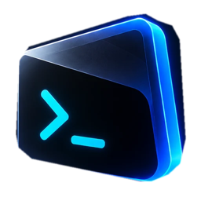

# FaKL-Code IDE

**Seus agentes de IA trabalham juntos, e você vê tudo acontecer.**

A IDE para Windows e macOS, baseada no VSCodium, onde Claude, Codex, Gemini e modelos
locais trabalham em paralelo, cada um no seu worktree.

[](LICENSE)
[](../../releases)
[](https://vscodium.com)
[](CONTRIBUTING.md)

[**Baixar**](../../releases) · [Documentação](docs/README.md) · [SDD](docs/sdd.md) · [ADRs](docs/adr/) · [Contribuir](CONTRIBUTING.md)

<br />

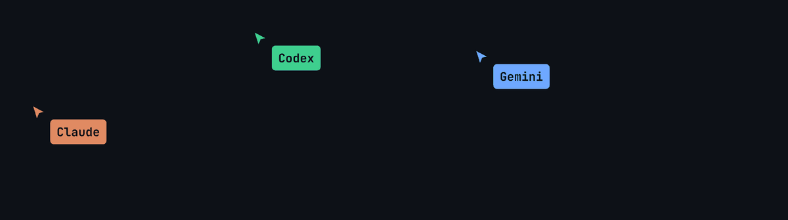

</div>

<br />

## `>_` O que é

A FaKL-Code é um fork do VSCodium feito para quem programa com vários agentes de IA
ao mesmo tempo. Você descreve a tarefa, o **Maestro** divide o trabalho entre os
agentes pelos perfis que você criou, cada agente trabalha no próprio worktree e
branch, e tudo chega de volta como diff para você revisar. Enquanto isso, o **cyber
café** mostra cada agente na sua mesa, com o monitor exibindo o que ele está
fazendo agora.

Tudo roda no seu computador, só enquanto a IDE está aberta. Não há serviço 24 horas
nem conta na nuvem: a IDE usa os logins das CLIs que você já tem.

<table>
  <tr>
    <td width="50%">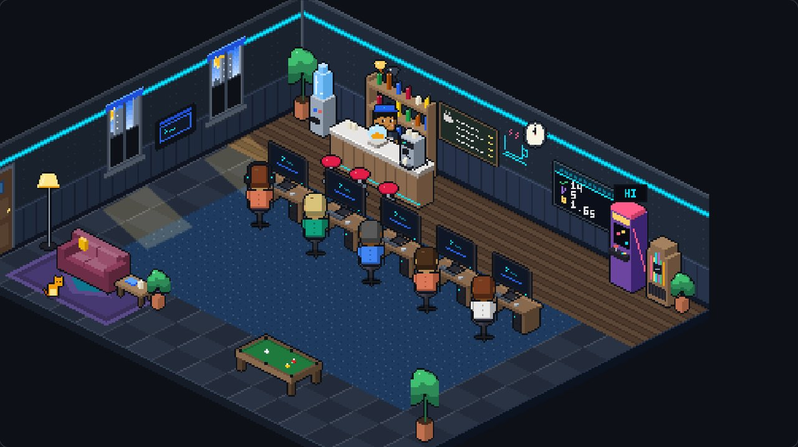</td>
    <td width="50%">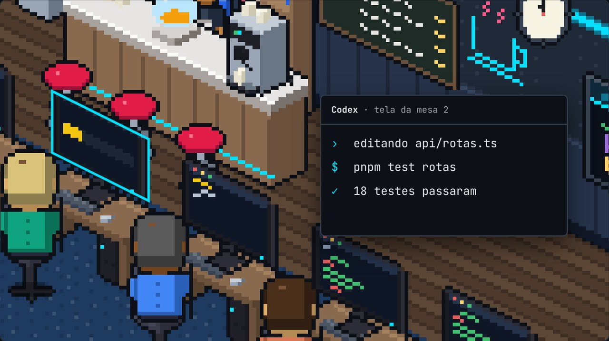</td>
  </tr>
  <tr>
    <td><sub><b>Cyber café.</b> Cada agente tem sua mesa.</sub></td>
    <td><sub>A tela mostra o que ele está fazendo. Terminou? Vai beber água.</sub></td>
  </tr>
</table>

## `>_` Elenco

| Agente                  | De                | Como entra                               |
| ----------------------- | ----------------- | ---------------------------------------- |
| **Claude Code**         | Anthropic         | Login do Claude Code ou chave de API     |
| **Codex**               | OpenAI            | `codex login` ou chave de API            |
| **Gemini CLI**          | Google            | Chave de API do Google AI Studio         |
| **Ollama e LM Studio**  | No seu computador | Servidor local com um modelo de conversa |
| **Qualquer agente ACP** | Você escolhe      | Login do próprio agente, ou uma chave    |

Todos são opcionais e combinam entre si. No Gemini, o login com conta Google pessoal
não funciona mais (o Google deixou de aceitá-lo fora dos produtos dele), então use uma
chave de API. Detalhes em [Provedores de IA](docs/provedores.md).

## `>_` Na IDE

<table>
  <tr>
    <td width="50%">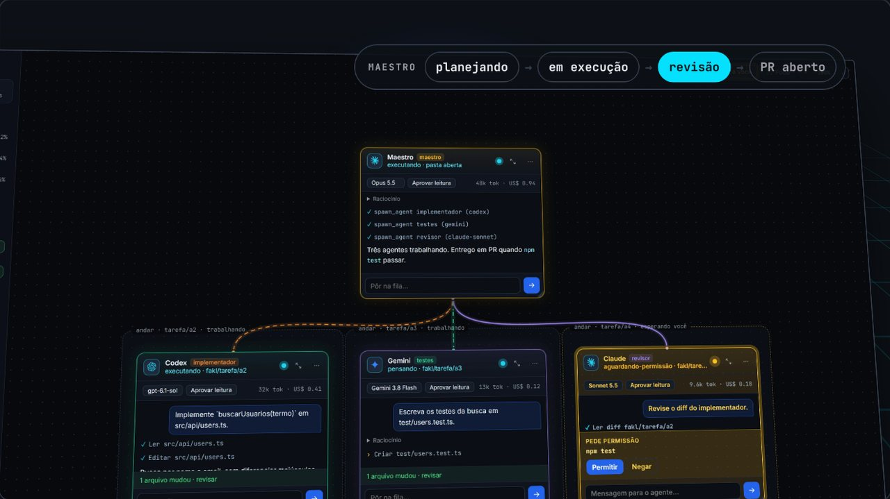</td>
    <td width="50%">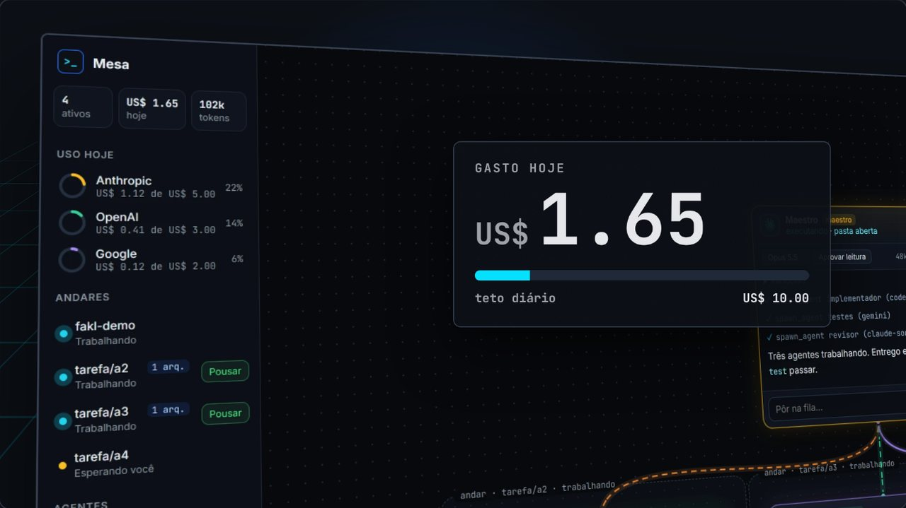</td>
  </tr>
  <tr>
    <td><sub><b>Mesa e Maestro.</b> Worktree e branch por agente, critérios de pronto, entrega em PR.</sub></td>
    <td><sub><b>Limites.</b> Rodadas, tempo, tokens, custo e teto diário de gasto.</sub></td>
  </tr>
  <tr>
    <td>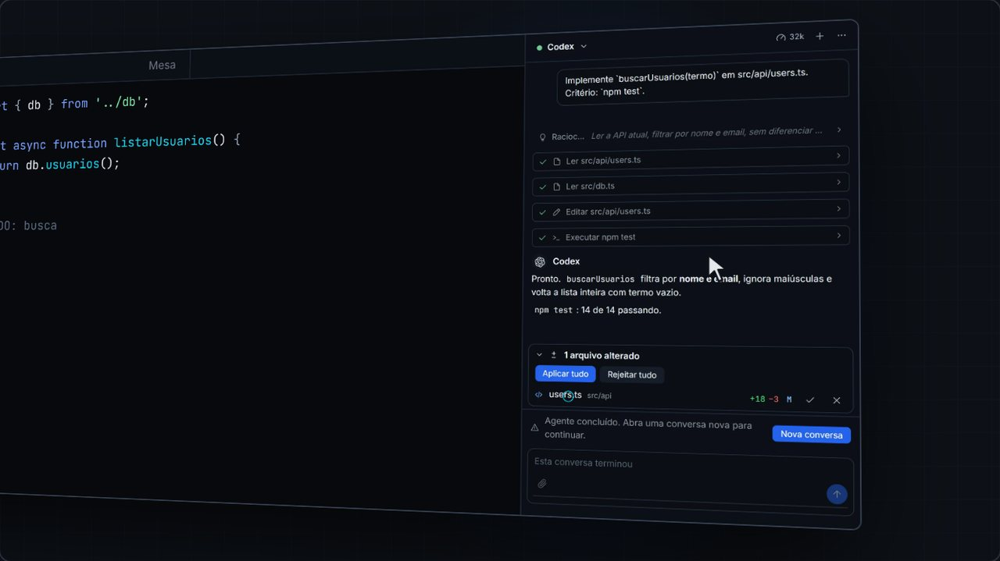</td>
    <td>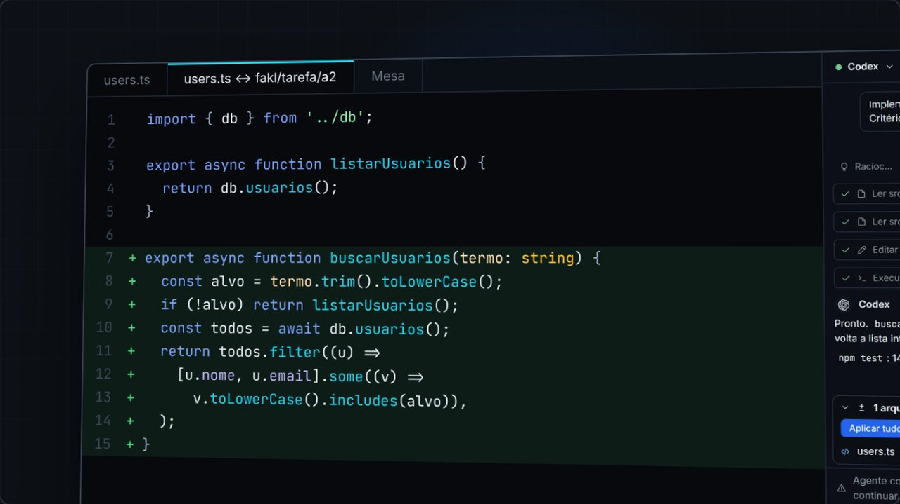</td>
  </tr>
  <tr>
    <td><sub><b>Chat por agente.</b> Logs, pausa e retomada.</sub></td>
    <td><sub><b>Revisão.</b> O que o agente mudou chega como diff e só vai para a sua pasta quando você aplica.</sub></td>
  </tr>
  <tr>
    <td>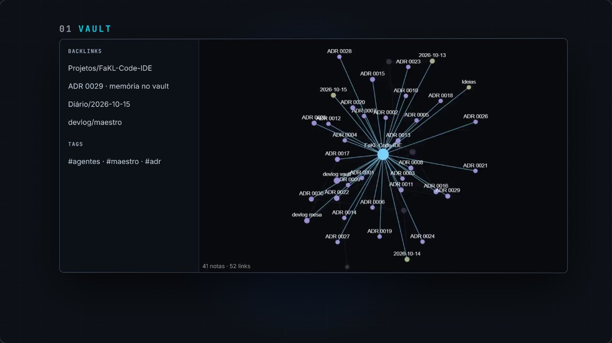</td>
    <td>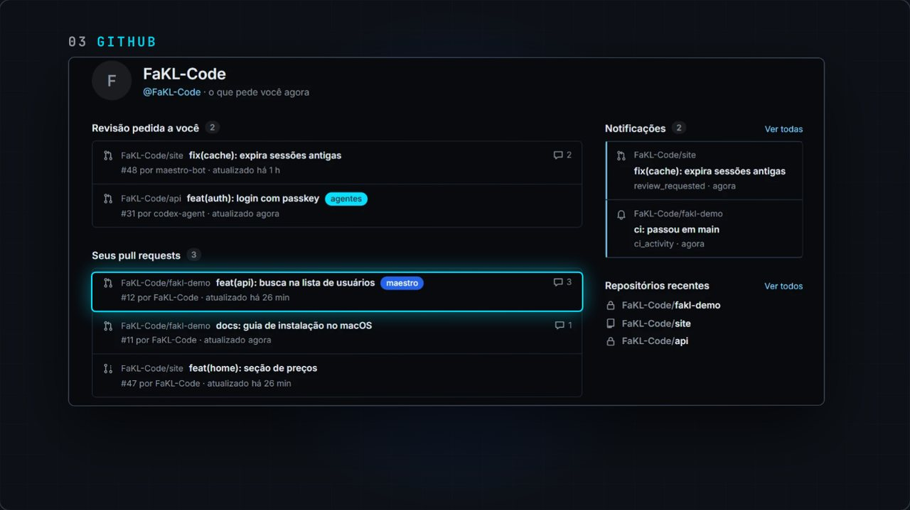</td>
  </tr>
  <tr>
    <td><sub><b>Vault.</b> Notas Markdown no estilo Obsidian, com grafo, backlinks, tags e sync por Git.</sub></td>
    <td><sub><b>GitHub.</b> PRs, revisões, issues e Actions de todos os repositórios.</sub></td>
  </tr>
</table>

|                      |                                                                                  |
| -------------------- | -------------------------------------------------------------------------------- |
| **Permissões**       | Do "perguntar tudo" ao autopilot. SSH, Hostinger e segredos sempre esperam você. |
| **Servidores**       | SSH com política por host, VPS e DNS da Hostinger, projetos Lovable.             |
| **Extensões e MCP**  | Marketplace aberto do VSCodium (Open VSX) e catálogo de servidores MCP.          |
| **Email**            | Caixas IMAP na IDE, com ferramentas de leitura para os agentes.                  |
| **Linha de comando** | `fakl`: o mesmo núcleo da IDE, no terminal.                                      |
| **Idiomas**          | Interface em português (Brasil) e em inglês, seguindo o idioma do sistema.       |

## `>_` Controle remoto

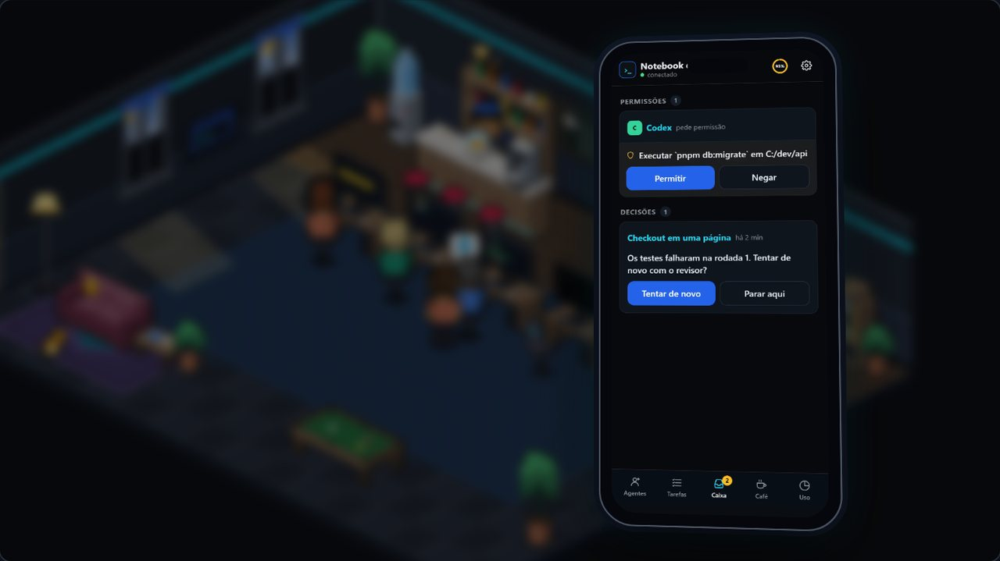

Pareie o celular por QR code e acompanhe a IDE de longe: execuções, agentes,
decisões, diffs e uma tarefa nova, tudo pelo app web instalável.

- Cifra de ponta a ponta entre a IDE e o aparelho. O relay só repassa bytes.
- Pedidos de permissão chegam como notificação.
- O relay roda no seu próprio VPS, num container.
- Funciona enquanto a IDE estiver aberta no seu computador.

<br clear="right" />

## `>_` Como funciona

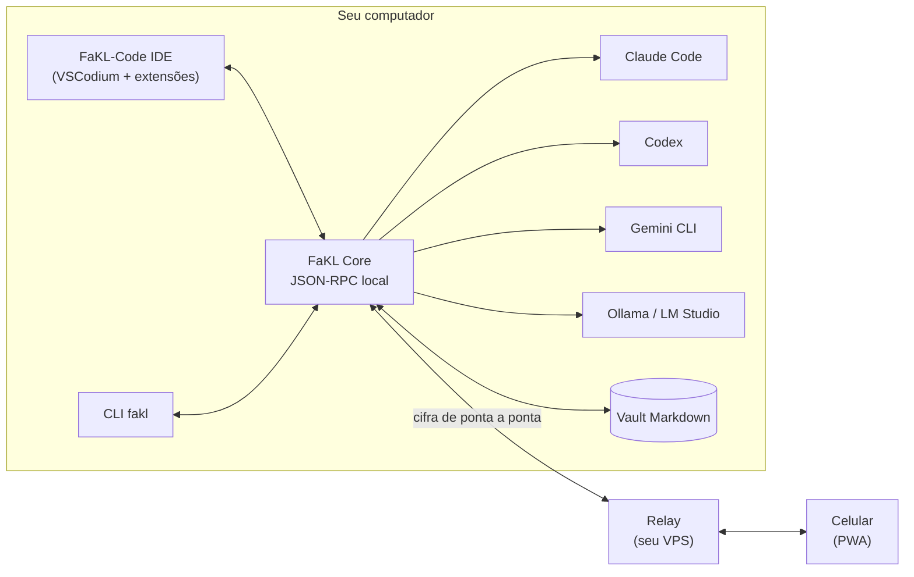

O **FaKL Core** sobe junto com a IDE e para quando ela fecha. Ele gerencia agentes,
tarefas, custos, vault e integrações, e atende a IDE, a CLI e o controle remoto pela
mesma API. Cada agente roda num worktree só dele, e o trabalho chega à `main` por PR.

## `>_` Instalação

Baixe o instalador na página de [Releases](../../releases) e confira o hash em
`SHA256SUMS.txt`.

| Sistema | Instalador    | Requisito                    |
| ------- | ------------- | ---------------------------- |
| Windows | x64           | Windows 10 ou 11, 64 bits    |
| macOS   | Apple Silicon | Mac com chip M1 ou mais novo |

- **Windows:** execute o `.exe`. O instalador não é assinado (o pedido ao SignPath
  Foundation foi recusado, veja [docs/assinatura.md](docs/assinatura.md)), então o
  SmartScreen mostra "O Windows protegeu o computador": clique em **Mais informações**
  e em **Executar assim mesmo**. Confira o hash com o `SHA256SUMS.txt` da release.
- **macOS (Apple Silicon):** o app não é notarizado pela Apple, então o macOS bloqueia
  a primeira abertura. Descompacte o `.zip`, mova o app para Applications e, uma vez,
  libere-o de um destes jeitos:
  - clique com o botão direito no app, **Abrir** e confirme; ou
  - rode `xattr -dr com.apple.quarantine "/Applications/FaKL-Code IDE.app"` no Terminal.

Na primeira abertura, a jornada de configuração guia a escolha de provedores de IA
(todos opcionais), GitHub, vault e as demais integrações.

## `>_` Desenvolvimento

Node na versão de [`.nvmrc`](.nvmrc) e pnpm via Corepack.

```sh
corepack enable
pnpm install   # dependências e ganchos de git
pnpm check     # o mesmo que o CI: termos, formato, build, lint, tipos e testes
```

O build completo da IDE recompila o VS Code e fica em [`docs/build.md`](docs/build.md).

<details>
<summary><b>Mapa do monorepo</b></summary>

| Pasta                             | O que é                                                                |
| --------------------------------- | ---------------------------------------------------------------------- |
| `packages/core`                   | FaKL Core: processo local que atende extensões, CLI e controle remoto  |
| `packages/agents`                 | Runtime de agentes e o adaptador ACP (Claude Code, Codex, Gemini CLI)  |
| `packages/protocol`               | Tipos e contratos JSON-RPC compartilhados                              |
| `packages/integrations`           | GitHub, Hostinger, `~/.ssh/config` e políticas de comando SSH          |
| `packages/remote`                 | Canal cifrado de ponta a ponta do controle remoto                      |
| `packages/relay`                  | Relay do controle remoto: casa Core e aparelhos, serve o PWA, Web Push |
| `packages/cafe`                   | A sala do cyber café em Canvas 2D                                      |
| `packages/conversa`               | A conversa com um agente: eventos, markdown e realce de sintaxe        |
| `packages/voz`                    | Comandos por voz e ditado em pt-BR                                     |
| `packages/cli`                    | CLI `fakl`                                                             |
| `packages/settings-sync`          | Importação do VS Code e sync de configurações por git                  |
| `packages/i18n`                   | Idioma da interface e catálogos pt-BR                                  |
| `extensions/fakl-core`            | Extensão principal: Mesa, chat, café, vault e integrações              |
| `extensions/fakl-settings`        | Configurações da FaKL-Code                                             |
| `apps/remote-pwa`                 | App do celular                                                         |
| `apps/overlay`                    | Modo minimizado: o pet e o painel dos agentes por cima de tudo         |
| `apps/landing`                    | Site da IDE: apresentação, documentação e download                     |
| `branding/`                       | Logo, ícones e `product.json` da marca                                 |
| `build/`, `patches/`, `upstream/` | Build da IDE sobre o VSCodium e o Code-OSS fixado                      |

</details>

## `>_` Documentação

- [SDD](docs/sdd.md): requisitos, arquitetura e contratos.
- [ADRs](docs/adr/): as decisões de arquitetura, uma por arquivo.
- [Provedores de IA](docs/provedores.md): assinatura, chave de API, modelo local ou agente ACP.
- [GitHub da conta inteira](docs/github.md): painéis, ferramentas dos agentes, SSO e tokens.
- [Email na IDE](docs/email.md): conexão IMAP e ferramentas de leitura para agentes.
- [Marca](docs/marca/README.md): logo, paleta e tipografia.

## `>_` Contribuir

Contribuições de pessoas e de agentes são bem-vindas. Leia o
[guia de contribuição](CONTRIBUTING.md): branch curto a partir da `main`,
[Conventional Commits](https://www.conventionalcommits.org/pt-br/), PR com o modelo
preenchido e o [CLA](CLA.md) assinado uma vez. Vulnerabilidades vão pelo
[processo de segurança](SECURITY.md), nunca em issue aberta.

## `>_` Licença

Copyright (c) 2026 FaKL-Code. Distribuído sob a [GNU AGPL-3.0](LICENSE)
(`AGPL-3.0-only`). O código do VS Code e do VSCodium mantém suas licenças MIT
originais, e os componentes de terceiros mantêm as licenças deles.

<div align="center">
<br />

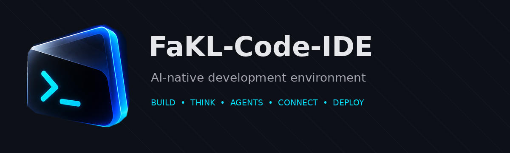

<sub><code>>_ Seus agentes. Seu café.</code></sub>

</div>
