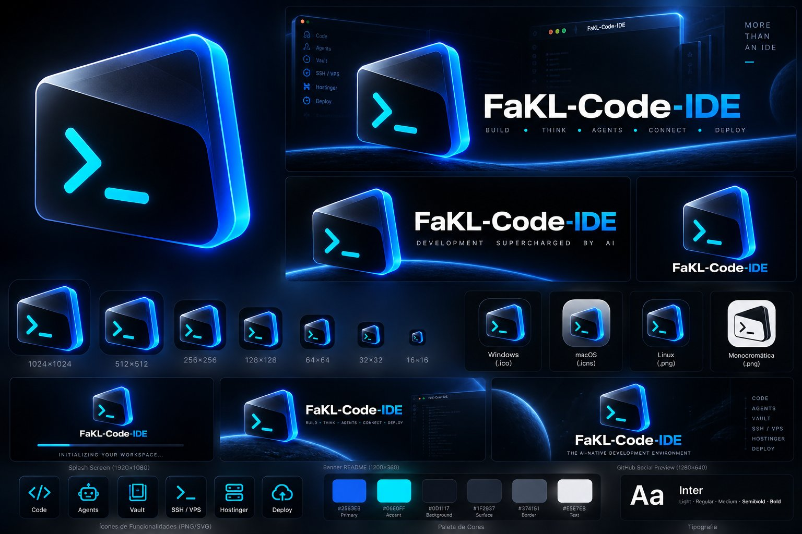

# Marca

Identidade **Terminal** da FaKL-Code IDE: um terminal em perspectiva com o
prompt `>_` em ciano, sobre fundo escuro com brilho azul. A decisão está no
[ADR 0015](../adr/0015-marca-terminal.md).

| Arquivo                                        | Uso                                               |
| ---------------------------------------------- | ------------------------------------------------- |
| [`../../branding/logo/`](../../branding/logo/) | Logo vetorial, fonte de todos os ícones da IDE    |
| [`banner.png`](banner.png)                     | Cabeçalho do README (1200×360)                    |
| [`social-preview.png`](social-preview.png)     | Prévia social do repositório no GitHub (1280×640) |
| [`tokens.json`](tokens.json)                   | Paleta                                            |

## Paleta

| Token      | Cor       |
| ---------- | --------- |
| Fundo      | `#0D1117` |
| Superfície | `#1F2937` |
| Borda      | `#374151` |
| Primária   | `#2563EB` |
| Destaque   | `#06E0FF` |
| Texto      | `#E5E7EB` |

Tipografia: Inter.

## Ícones

Os ícones da IDE (macOS, Windows, Linux, web, instalador e marca d'água do
editor vazio) saem de `branding/logo/` com `pnpm --filter @fakl/branding icons`.
O logo foi redesenhado em vetor a partir da arte aprovada: o PNG do kit tem
recorte aproximado e some em 16 e 32 px, enquanto o vetor fica nítido em todos
os tamanhos e gera a versão monocromática.
