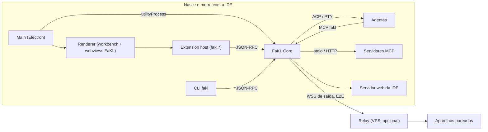
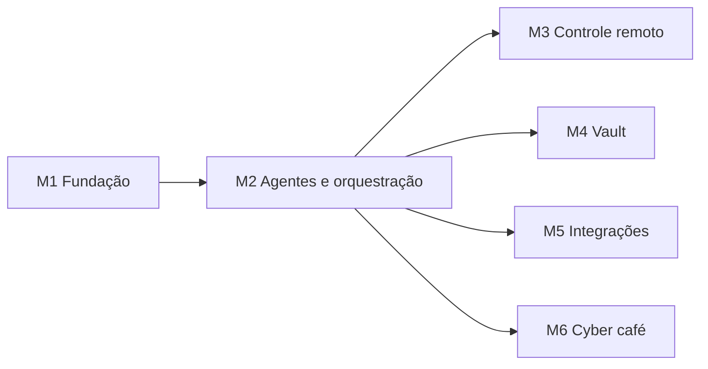

# FaKL-Code IDE — SDD

> Software Design Document. Fonte de verdade da arquitetura e dos requisitos da
> FaKL-Code IDE, e especificação usada pelos agentes que implementam a IDE.
> Versão inicial de 2026-10-11, aprovada pelos mantenedores. Mudanças neste
> documento entram por PR com o escopo `docs` e, quando alteram uma decisão de
> arquitetura, vêm acompanhadas de uma ADR em [`adr/`](adr/).

## 1. Introdução

Este documento define como a FaKL-Code IDE será construída: requisitos com IDs rastreáveis, arquitetura, contratos entre componentes, modelo de dados e marcos de entrega. Ele detalha o [plano do projeto](https://claude.ai/code/artifact/460f98e7-8c5a-44fd-876e-4549f7739c1a) e serve também de especificação para os próprios agentes que vão implementar a IDE.

### 1.1 Escopo

Uma IDE desktop para Windows e macOS, fork do VSCodium, com: central de agentes de IA multi-provedor com orquestração por maestro; vault Markdown compatível com Obsidian e sincronizado entre máquinas; GitHub, SSH, Hostinger e Lovable integrados; controle remoto enquanto a IDE estiver aberta; e um cyber café animado que mostra o trabalho dos agentes.

### 1.2 Fora de escopo

- Linux como plataforma oficial (o build pode funcionar, mas não é testado nem distribuído).
- Qualquer serviço rodando com a IDE fechada, exceto o relay opcional do controle remoto no seu próprio VPS (seção 12).
- Marketplace da Microsoft e extensões proprietárias da Microsoft.
- Uso por equipes e multiusuário; a IDE é de um usuário só, em duas máquinas.
- Treinar ou hospedar modelos de IA.

### 1.3 Glossário

| Termo              | Significado                                                                                                              |
| ------------------ | ------------------------------------------------------------------------------------------------------------------------ |
| Core               | Processo local da FaKL que gerencia agentes, cofre, vault, conexões e eventos. Vive enquanto a IDE estiver aberta.       |
| Agente             | Uma instância de um provedor de IA (Claude Code, Codex, Gemini, Lovable, modelo local) executando uma tarefa.            |
| Perfil de agente   | Configuração reutilizável que descreve um agente: provedor, modelo, pontos fortes, custo, ferramentas liberadas, regras. |
| Maestro            | Agente que recebeu o papel de dividir uma tarefa, criar subagentes, revisar e iterar.                                    |
| Tarefa             | Unidade de trabalho com objetivo, critério de pronto e limites.                                                          |
| Execução (run)     | Uma tentativa de cumprir uma tarefa, composta de rodadas.                                                                |
| Rodada             | Um ciclo do loop: delegar, executar, avaliar.                                                                            |
| Critério de pronto | Conjunto de verificações que encerra o loop com sucesso.                                                                 |
| Política de limite | O que fazer quando um limite (rodadas, tempo, tokens, custo) estoura.                                                    |
| Playbook           | Fluxo de trabalho reutilizável salvo como nota no vault.                                                                 |
| Worktree           | Cópia de trabalho isolada de um repositório git, uma por agente.                                                         |
| Vault              | Pasta de notas Markdown no formato do Obsidian.                                                                          |
| Relay              | Servidor intermediário opcional que repassa tráfego criptografado do controle remoto.                                    |
| ACP                | Agent Client Protocol, protocolo JSON-RPC aberto para conversar com agentes de código.                                   |
| MCP                | Model Context Protocol, protocolo aberto para expor ferramentas a modelos.                                               |

### 1.4 Convenções

Requisitos funcionais usam o prefixo RF, não funcionais RNF. "Deve" indica obrigatório para o marco indicado; "pode" indica opcional.

## 2. Requisitos funcionais

Cada requisito tem um marco (M1 a M6, seção 16) e um critério de aceite verificável. Os agentes que implementarem a IDE usam esses critérios como critério de pronto.

### 2.1 Base da IDE

| ID     | Requisito                                                                                                                   | Marco | Critério de aceite                                                                             |
| ------ | --------------------------------------------------------------------------------------------------------------------------- | ----- | ---------------------------------------------------------------------------------------------- |
| RF-001 | A IDE deve ser instalável no Windows x64 e no macOS arm64 e x64 com nome, ícones e tema FaKL-Code                           | M1    | Instaladores gerados pelo CI instalam e abrem nas três arquiteturas                            |
| RF-002 | A IDE deve usar o Open VSX como galeria e aceitar instalação manual de .vsix                                                | M1    | Buscar, instalar e atualizar uma extensão do Open VSX funciona                                 |
| RF-003 | A IDE deve se atualizar sozinha a partir dos GitHub Releases                                                                | M1    | Uma versão nova publicada é oferecida e instalada sem reinstalação manual                      |
| RF-004 | A IDE deve importar settings, atalhos e lista de extensões do VS Code instalado                                             | M1    | Primeiro uso oferece a importação e reproduz a configuração                                    |
| RF-005 | A IDE deve sincronizar settings, atalhos, perfis de agentes e extensões entre máquinas por um repositório privado no GitHub | M1    | Mudança numa máquina aparece na outra após o próximo sync                                      |
| RF-006 | A IDE deve carregar servidores MCP configurados pelo usuário e disponibilizá-los a todos os agentes                         | M2    | Um servidor MCP do arquivo de configuração aparece como ferramenta para Claude, Codex e Gemini |

### 2.2 Agentes

| ID     | Requisito                                                                                                    | Marco | Critério de aceite                                                    |
| ------ | ------------------------------------------------------------------------------------------------------------ | ----- | --------------------------------------------------------------------- |
| RF-101 | O usuário deve criar, editar e apagar perfis de agente                                                       | M2    | Perfil salvo persiste após reiniciar e sincroniza entre máquinas      |
| RF-102 | A IDE deve executar agentes Claude Code, Codex CLI e Gemini CLI usando o login ou a chave do usuário         | M2    | Uma tarefa simples conclui em cada provedor                           |
| RF-103 | A IDE deve executar qualquer agente compatível com ACP ou qualquer CLI de terminal por um adaptador genérico | M2    | Um agente ACP de terceiros roda sem código novo                       |
| RF-104 | A IDE deve suportar modelos locais via Ollama e LM Studio                                                    | M2    | Com Ollama instalado, um perfil local executa uma tarefa              |
| RF-105 | Cada agente deve trabalhar num git worktree e num terminal próprios                                          | M2    | Dois agentes no mesmo repositório não alteram os arquivos um do outro |
| RF-106 | A mesa de controle deve mostrar a árvore de agentes ao vivo com status, custo, logs e terminal               | M2    | Estados mudam na tela em menos de 1 s após o evento                   |
| RF-107 | O usuário deve ver o diff de cada agente e aceitar ou rejeitar por arquivo                                   | M2    | Aceitar aplica no branch da tarefa; rejeitar descarta                 |
| RF-108 | O usuário deve poder pausar, retomar, parar e mandar mensagem a qualquer agente                              | M2    | A ação tem efeito em até 2 s                                          |
| RF-109 | A IDE deve notificar pelo sistema quando um agente termina, falha ou pede decisão                            | M2    | Notificação nativa aparece no Windows e no macOS                      |
| RF-110 | Ao fechar a IDE com agentes ativos, ela deve perguntar: esperar terminar, ou parar agora                     | M2    | Ambas as opções funcionam; nenhum processo sobra após o fechamento    |

### 2.3 Orquestração

| ID     | Requisito                                                                                                                                         | Marco | Critério de aceite                                                  |
| ------ | ------------------------------------------------------------------------------------------------------------------------------------------------- | ----- | ------------------------------------------------------------------- |
| RF-201 | Qualquer perfil pode ser designado maestro de uma tarefa                                                                                          | M2    | Maestro recebe as ferramentas de orquestração via MCP               |
| RF-202 | O maestro deve criar subagentes de qualquer perfil, delegar subtarefas e receber resultados                                                       | M2    | Uma tarefa gera pelo menos dois subagentes de provedores diferentes |
| RF-203 | Subagentes podem atuar como maestros até uma profundidade máxima configurável                                                                     | M2    | Pedido acima da profundidade é recusado com erro claro              |
| RF-204 | O maestro deve escolher subagentes pelos perfis e pela tarefa, respeitando papéis fixados pelo usuário                                            | M2    | Papel fixado num playbook é sempre obedecido                        |
| RF-205 | Cada tarefa deve ter critério de pronto composto de comandos, checklist e/ou revisão por agente                                                   | M2    | O loop só termina com sucesso quando todas as verificações passam   |
| RF-206 | Limites de rodadas, tempo, tokens e custo devem ser configuráveis globalmente, por playbook e por tarefa                                          | M2    | O valor mais específico prevalece                                   |
| RF-207 | Cada limite deve ter política configurável: pausar e perguntar, entregar PR rascunho, escalar para outro perfil com orçamento extra, ou descartar | M2    | Cada política é acionada ao estourar o limite correspondente        |
| RF-208 | Playbooks devem ser definidos como notas no vault, com limites e critério de pronto, e executáveis por nome                                       | M2    | Editar o playbook no vault muda o próximo uso                       |
| RF-209 | O resultado aprovado deve virar merge local ou PR no GitHub, conforme configuração                                                                | M2    | PR criado com descrição gerada e selo do agente                     |
| RF-210 | Tarefas podem nascer de issue do GitHub, nota do vault, controle remoto ou CLI                                                                    | M2    | As quatro origens criam tarefas equivalentes                        |

### 2.4 Controle remoto

| ID     | Requisito                                                                                       | Marco | Critério de aceite                               |
| ------ | ----------------------------------------------------------------------------------------------- | ----- | ------------------------------------------------ |
| RF-301 | O usuário deve parear um aparelho por QR code exibido na IDE                                    | M3    | Celular pareado acessa o painel em menos de 30 s |
| RF-302 | O cliente remoto deve mostrar árvore de agentes, diffs, logs, decisões pendentes e o cyber café | M3    | Mesmas informações da mesa de controle           |
| RF-303 | O cliente remoto deve criar tarefas, aprovar decisões, pausar e parar agentes                   | M3    | Ações refletem na IDE em até 2 s                 |
| RF-304 | A IDE completa deve poder ser aberta no navegador de outro computador                           | M3    | Editar e salvar arquivo pelo navegador funciona  |
| RF-305 | O acesso remoto deve ter liga/desliga na barra de status e lista de aparelhos revogáveis        | M3    | Aparelho revogado perde acesso imediatamente     |
| RF-306 | O cliente deve receber notificações push de decisões pendentes                                  | M3    | Push chega com a tela do celular bloqueada       |

### 2.5 Vault

| ID     | Requisito                                                                                   | Marco | Critério de aceite                                       |
| ------ | ------------------------------------------------------------------------------------------- | ----- | -------------------------------------------------------- |
| RF-401 | A IDE deve abrir um vault global em formato Obsidian (wikilinks, frontmatter, embeds, tags) | M4    | Um vault criado no Obsidian abre sem perda               |
| RF-402 | O vault deve sincronizar entre máquinas por repositório git privado, sem o estado do editor | M4    | Nota criada numa máquina aparece na outra em até 5 min   |
| RF-403 | O painel do vault deve ter busca, backlinks, tags, grafo, notas diárias e templates         | M4    | Cada função opera sobre o vault de teste                 |
| RF-404 | O editor Markdown deve ter preview ao vivo, Mermaid, callouts e embed de notas              | M4    | Renderização igual ao Obsidian nos casos de teste        |
| RF-405 | Agentes devem buscar, ler e escrever no vault via MCP                                       | M4    | Um agente cita uma nota existente numa resposta          |
| RF-406 | Cada sessão de agente deve gerar uma nota com pedido, decisões, custo e resultado           | M4    | Nota aparece em Agentes/Sessões ao fim da execução       |
| RF-407 | A busca semântica pode ser ativada com embeddings locais ou por API                         | M4    | Busca por significado retorna nota sem a palavra literal |

### 2.6 Integrações

| ID     | Requisito                                                                                             | Marco | Critério de aceite                                                        |
| ------ | ----------------------------------------------------------------------------------------------------- | ----- | ------------------------------------------------------------------------- |
| RF-501 | Login no GitHub uma vez, compartilhado por IDE, git e agentes                                         | M5    | git push e API funcionam sem novo login                                   |
| RF-502 | Painéis de PRs, issues, Actions, releases e notificações                                              | M5    | Revisar, comentar, aprovar e fazer merge sem sair da IDE                  |
| RF-503 | Gerenciador de hosts SSH lendo ~/.ssh/config, com grupos e tags                                       | M5    | Hosts existentes aparecem sem configuração extra                          |
| RF-504 | Abrir pasta remota via SSH como workspace                                                             | M5    | Editar, rodar terminal e encaminhar porta num host remoto                 |
| RF-505 | Ferramenta de SSH para agentes com política por host: livre, confirmar, só leitura, bloqueado         | M5    | Comando fora da política é bloqueado ou pede confirmação                  |
| RF-506 | Painel da Hostinger: VPS, domínios, DNS, status, reinício e snapshots                                 | M5    | Criar registro DNS pela IDE reflete no painel da Hostinger                |
| RF-507 | VPS da Hostinger entram automaticamente no gerenciador de SSH                                         | M5    | VPS novo aparece como host                                                |
| RF-508 | Snapshot automático antes de um agente executar comando de escrita num VPS da Hostinger               | M5    | Snapshot existe com timestamp anterior ao comando                         |
| RF-509 | Projetos Lovable abertos pelo repositório sincronizado no GitHub, com atalho para o editor do Lovable | M5    | Mudança feita por agente aparece no Lovable após o push                   |
| RF-510 | Caixas IMAP com TLS na IDE, com leitura da INBOX por agentes sem expor credenciais                    | M5    | Caixa aparece na IDE e agente lê mensagens marcadas como conteúdo externo |

### 2.7 Cyber café

| ID     | Requisito                                                         | Marco | Critério de aceite                               |
| ------ | ----------------------------------------------------------------- | ----- | ------------------------------------------------ |
| RF-601 | Sala isométrica em pixel art com um avatar por agente ativo       | M6    | Avatares surgem e somem com os agentes           |
| RF-602 | Monitor de cada PC mostra miniatura ao vivo do trabalho do agente | M6    | Miniatura atualiza pelo menos a cada 2 s         |
| RF-603 | Estados do agente viram animações distintas (tabela da seção 13)  | M6    | Cada estado tem animação própria                 |
| RF-604 | Ao concluir tarefa, o avatar faz uma atividade de pausa e volta   | M6    | Pausa dura entre 20 e 60 s e não atrasa o agente |
| RF-605 | Clicar num PC abre a sessão do agente na mesa de controle         | M6    | Abre a sessão certa                              |
| RF-606 | Placar do dia com tarefas, PRs e custo                            | M6    | Valores batem com a mesa de controle             |

## 3. Requisitos não funcionais

| ID     | Categoria      | Requisito                                                                                              | Como medir                                                  |
| ------ | -------------- | ------------------------------------------------------------------------------------------------------ | ----------------------------------------------------------- |
| RNF-01 | Plataforma     | Windows 10 e 11 x64; macOS 13 ou superior, arm64 e x64                                                 | Matriz de CI e teste manual nas suas duas máquinas          |
| RNF-02 | Desempenho     | Abertura da IDE no máximo 20% mais lenta que o VSCodium da mesma versão                                | Teste de inicialização automatizado no CI                   |
| RNF-03 | Desempenho     | Core ocioso usa menos de 150 MB de RAM e menos de 1% de CPU                                            | Medição com 0 agentes ativos                                |
| RNF-04 | Desempenho     | Pelo menos 8 agentes simultâneos sem travar a interface                                                | Teste de carga com agentes simulados                        |
| RNF-05 | Ciclo de vida  | Nenhum processo FaKL permanece após fechar a IDE                                                       | Verificação da lista de processos após fechar               |
| RNF-06 | Resiliência    | Se o Core cair, a IDE o reinicia e as tarefas retomam da última rodada salva                           | Teste matando o processo do Core                            |
| RNF-07 | Segurança      | Nenhum segredo gravado em texto puro no disco, em logs ou no vault                                     | Varredura automática de segredos nos testes                 |
| RNF-08 | Segurança      | Todo tráfego do controle remoto criptografado de ponta a ponta; o relay não enxerga conteúdo           | Revisão do protocolo e teste com relay instrumentado        |
| RNF-09 | Privacidade    | Sem telemetria; o único tráfego de saída é para serviços que você configurou                           | Inspeção de rede numa sessão padrão                         |
| RNF-10 | Manutenção     | Atualizar para uma versão nova do VS Code exige no máximo ajustes nos patches, sem reescrever features | Patches no core restritos às áreas da seção 5.3             |
| RNF-11 | Manutenção     | Features novas vivem em extensões embutidas ou no Core, nunca espalhadas pelo código do VS Code        | Revisão de código                                           |
| RNF-12 | Portabilidade  | Caminhos, shells e terminais funcionam igual no Windows (PowerShell, Git Bash) e no macOS (zsh)        | Testes de integração nos dois sistemas                      |
| RNF-13 | Custo          | Gasto com provedores visível em tempo real e com teto diário                                           | Painel de custos e teste de teto                            |
| RNF-14 | Acessibilidade | Mesa de controle e vault navegáveis por teclado e leitor de tela                                       | Checagem com as ferramentas de acessibilidade do VS Code    |
| RNF-15 | Idioma         | Interface em português do Brasil, com inglês disponível                                                | Strings externalizadas no sistema de localização do VS Code |

## 4. Arquitetura de processos

O Core é um processo filho da IDE, iniciado pelo processo principal do Electron e encerrado com ele. Toda a lógica nova (agentes, orquestração, vault, conexões) vive no Core; as extensões embutidas são só interface. Isso permite que a mesa de controle, a CLI e o controle remoto usem exatamente a mesma API.



Tudo dentro da área sombreada nasce e morre com a IDE; o relay no seu VPS é o único componente sempre ligado, e só repassa tráfego criptografado.

| Processo                     | Papel                                                                             | Inicia quando                       | Fala com                                      |
| ---------------------------- | --------------------------------------------------------------------------------- | ----------------------------------- | --------------------------------------------- |
| Main (Electron)              | Janelas, ciclo de vida, atualização; inicia e encerra o Core                      | Abertura da IDE                     | Core por utilityProcess                       |
| Renderer (workbench)         | Interface do VS Code e webviews FaKL (chat, mesa de controle, vault, café)        | Cada janela                         | Extension host                                |
| Extension host               | Extensões embutidas fakl.* e extensões do usuário                                 | Cada janela                         | Core por JSON-RPC                             |
| FaKL Core                    | Orquestrador, runtime de agentes, cofre, vault, conexões, eventos, gateway remoto | Primeira janela aberta              | Tudo                                          |
| Agentes                      | Claude Code, Codex, Gemini, adaptador genérico, modelos locais                    | Sob demanda, pelo Core              | Core por ACP ou PTY; ferramentas FaKL por MCP |
| Servidores MCP               | Ferramentas de terceiros configuradas pelo usuário                                | Primeiro uso                        | Core por stdio ou HTTP                        |
| Servidor web da IDE          | IDE completa no navegador (RF-304)                                                | Ao ativar o acesso remoto ao editor | Core e navegador remoto                       |
| Relay (opcional, no seu VPS) | Repassa tráfego criptografado do controle remoto                                  | Sempre ligado no VPS                | Core e aparelhos pareados                     |

### 4.1 Canais

- **Extensões e CLI para o Core:** JSON-RPC 2.0 sobre named pipe no Windows (`\\.\pipe\fakl-core-<usuário>`) e socket Unix no macOS (`~/.fakl/run/core.sock`). Nada escuta em porta TCP por padrão. Cada cliente se autentica com um token de sessão gerado a cada inicialização.
- **Core para agentes:** ACP (JSON-RPC sobre stdio) quando o agente suporta; PTY com parser de saída para os demais.
- **Agentes para o Core:** o Core expõe um servidor MCP próprio (`fakl`) via Streamable HTTP em 127.0.0.1 com porta aleatória e token por agente. Cada token carrega as permissões daquele agente.
- **Core para o controle remoto:** conexão de saída WSS até o relay, com criptografia de ponta a ponta entre o Core e o aparelho (seção 12).

### 4.2 Por que o Core é um processo separado

- Um travamento de agente ou de parser não congela a interface.
- O mesmo Core atende várias janelas da IDE ao mesmo tempo.
- A CLI e o controle remoto não dependem de uma janela específica estar em foco.
- O ciclo de vida continua preso à IDE: o processo principal encerra o Core ao fechar a última janela (RF-110, RNF-05).

## 5. Stack técnica e repositório

### 5.1 Stack

| Camada               | Escolha                                                                                | Motivo                                                                         |
| -------------------- | -------------------------------------------------------------------------------------- | ------------------------------------------------------------------------------ |
| Base                 | Code-OSS compilado com os scripts do VSCodium, versão fixada em `upstream/stable.json` | Mesmo caminho já testado pelo VSCodium para gerar binários sem marca Microsoft |
| Linguagem            | TypeScript em tudo (core patches, extensões, Core, CLI, cliente remoto)                | Uma linguagem, tipos compartilhados                                            |
| Monorepo             | pnpm workspaces                                                                        | Pacotes compartilhando tipos e build incremental                               |
| Core                 | Node do próprio Electron via utilityProcess                                            | Sem runtime extra para instalar                                                |
| Persistência         | SQLite (módulo nativo compilado para o Electron)                                       | Arquivo único, transacional, com busca de texto FTS5                           |
| Terminais            | node-pty e @xterm/headless                                                             | Os mesmos que o VS Code usa; o buffer headless alimenta logs e miniaturas      |
| Protocolo de agentes | ACP (SDK TypeScript oficial) e adaptador PTY                                           | ACP já é suportado pelo Gemini CLI e por adaptadores para Claude Code e Codex  |
| Claude               | Claude Agent SDK como alternativa ao ACP                                               | Controle fino de ferramentas, permissões e custo                               |
| Ferramentas          | SDK TypeScript oficial do MCP                                                          | Servidor `fakl` e cliente para MCPs do usuário                                 |
| Git                  | git do sistema, chamado pelo Core                                                      | Worktrees e credenciais do sistema funcionam sem reimplementar                 |
| Interfaces           | React + Vite nas webviews, com o toolkit de webview do VS Code                         | Visual consistente com a IDE                                                   |
| Cyber café           | Canvas 2D com pixel art em código (ADR 0011)                                           | Cena pequena, sem dependência nem WebGL, pausa total quando oculta             |
| Criptografia         | libsodium                                                                              | Primitivas modernas para pareamento e canal de ponta a ponta                   |
| Cliente remoto       | PWA em React, servido pelo relay                                                       | Funciona no iPhone e no Android sem loja de apps                               |
| Relay                | Serviço Node mínimo em container, no seu VPS da Hostinger                              | Você controla a infraestrutura                                                 |
| Testes               | Vitest, Playwright para Electron, runner de testes de extensão do VS Code              | Cobrem unidade, integração e ponta a ponta                                     |

### 5.2 Estrutura do repositório

```text
FaKL-Code-IDE/
  upstream/            versão fixada do Code-OSS e scripts do VSCodium
  patches/             patches no core, um arquivo por área (5.3)
  branding/            ícones, logos, temas, tela de boas-vindas, product.json
  extensions/          extensões embutidas
    fakl-core/         agentes, Mesa, chat, vault, GitHub, SSH, Hostinger, café, remoto, Doctor e tour
    fakl-settings/     importar e sincronizar as configurações
  packages/
    core/              FaKL Core (agentes, orquestração, vault, integrações, servidor MCP em core/src/mcp)
    protocol/          tipos e contratos JSON-RPC compartilhados
    agents/            adaptadores de provedores (acp, ollama e LM Studio)
    integrations/      GitHub, SSH, Hostinger, e-mail
    conversa/          transcrição, markdown e formatação das conversas
    cafe/              sala do cyber café
    remote/            canal cifrado do controle remoto
    relay/             relay para o VPS
    settings-sync/     importação e sincronização de configurações
    voz/               comandos por voz
    i18n/              textos e catálogos pt-BR
    cli/               CLI fakl
  apps/
    remote-pwa/        cliente do controle remoto
    overlay/           modo minimizado
    landing/           site da IDE
  docs/                este SDD em Markdown, ADRs, playbooks de desenvolvimento
  .github/workflows/   build, release, sync com upstream
```

### 5.3 Áreas onde o core do VS Code é alterado

Só estas áreas recebem patches; todo o resto é extensão ou Core (RNF-10, RNF-11).

1. product.json: nome, identificadores, galeria Open VSX, URLs de atualização.
2. Marca: ícones, nome nas janelas, tela de boas-vindas.
3. Ciclo de vida: o processo principal inicia o Core, repassa o token aos extension hosts e pergunta antes de fechar com agentes ativos.
4. Layout padrão: barra de atividades com Agentes, Vault, GitHub e Remoto no topo.
5. Atualização: serviço de update apontado para os GitHub Releases.
6. Permissões dos webviews: microfone, só áudio, para os comandos por voz (ADR 0031).

## 6. FaKL Core

### 6.1 Ciclo de vida

1. A primeira janela da IDE abre; o processo principal inicia o Core como utilityProcess e gera um token de sessão.
2. O Core abre o banco SQLite, carrega configuração e perfis, conecta ao cofre e abre o named pipe ou socket.
3. O Core retoma execuções que estavam em andamento quando a IDE fechou com "parar agora", marcando-as como pausadas, e notifica a mesa de controle.
4. Ao fechar a última janela, o processo principal pergunta ao Core se há agentes ativos. Se houver, mostra o diálogo de RF-110.
5. "Esperar terminar" mantém a IDE minimizada com um ícone na bandeja até as execuções terminarem; "Parar agora" salva o estado de cada rodada e encerra os agentes.
6. O Core grava o estado final, fecha o banco e sai. O processo principal confirma que não sobrou nenhum processo filho.

### 6.2 Módulos

| Módulo         | Responsabilidade                                                                 |
| -------------- | -------------------------------------------------------------------------------- |
| `rpc`          | Servidor JSON-RPC, autenticação por token, roteamento de métodos                 |
| `events`       | Barramento de eventos em memória com persistência em log e assinatura por tópico |
| `store`        | Arquivos JSON e JSON Lines em `~/.fakl/data` (ADR 0007)                          |
| `config`       | Leitura de `~/.fakl/config.yaml`, perfis e políticas; observa mudanças           |
| `vault-keys`   | Cofre de credenciais (seção 14)                                                  |
| `runtime`      | Ciclo de vida de sessões de agente, worktrees e PTYs (seção 8)                   |
| `orchestrator` | Tarefas, execuções, rodadas, critérios de pronto e limites (seção 9)             |
| `mcp-hub`      | Servidor MCP `fakl` e clientes para os MCPs do usuário                           |
| `notes`        | Vault: arquivos, índice e sincronização (seção 10)                               |
| `connectors`   | GitHub, SSH, Hostinger, Lovable (seção 11)                                       |
| `remote`       | Gateway do controle remoto (seção 12)                                            |
| `costs`        | Contabilidade de tokens e custo por agente, tarefa, provedor e dia               |
| `audit`        | Registro imutável de ações sensíveis                                             |

### 6.3 API local

JSON-RPC 2.0. Os nomes seguem `domínio.ação`. Os mesmos métodos atendem extensões, CLI e controle remoto; o que muda é o escopo do token.

| Domínio     | Métodos                                                                                                                                                              |
| ----------- | -------------------------------------------------------------------------------------------------------------------------------------------------------------------- |
| `profiles`  | `list`, `get`, `upsert`, `delete`                                                                                                                                    |
| `tasks`     | `create`, `list`, `get`, `cancel`, `fromIssue`, `fromNote`                                                                                                           |
| `runs`      | `start`, `pause`, `resume`, `stop`, `get`, `tree`, `decide`                                                                                                          |
| `agents`    | `detect`, `start`, `list`, `send`, `pause`, `resume`, `stop`, `permission`, `terminal.attach`, `terminal.detach`, `diff`, `fileContent`, `applyFiles`, `rejectFiles` |
| `playbooks` | `list`, `get`, `run`                                                                                                                                                 |
| `vault`     | `status`, `search`, `read`, `write`, `backlinks`, `graph`, `tags`, `sync`, `appendDaily`, `daily`                                                                    |
| `github`    | `prs.list`, `prs.review`, `prs.merge`, `issues.list`, `actions.list`, `actions.logs`, `account.*` (repos, orgs, prs, issues, actions, notifications)                 |
| `ssh`       | `hosts.list`, `hosts.upsert`, `exec`, `policy.get`, `policy.set`                                                                                                     |
| `hostinger` | `vps.list`, `vps.restart`, `vps.snapshot`, `dns.list`, `dns.upsert`, `domains.list`, `firewall.*`                                                                    |
| `resources` | `list`, `catalog`, `install`, `create`, `remove`, `get`                                                                                                              |
| `sources`   | `list`, `add`, `remove`, `update`                                                                                                                                    |
| `remote`    | `status`, `enable`, `disable`, `pair.begin`, `devices.list`, `devices.revoke`                                                                                        |
| `costs`     | `summary`, `byTask`, `limits.get`, `limits.set`                                                                                                                      |
| `events`    | `subscribe`, `unsubscribe`, `replay`                                                                                                                                 |

### 6.4 Eventos

Todo evento tem `id`, `ts`, `topic`, `subject` (id do agente, tarefa ou execução) e `data`. A mesa de controle, o café e o controle remoto só consomem eventos; nenhum deles consulta o estado por polling.

| Tópico             | Quando                                                     |
| ------------------ | ---------------------------------------------------------- |
| `agent.state`      | Mudança de estado da sessão (seção 8.3)                    |
| `agent.output`     | Novo trecho de saída ou mensagem                           |
| `agent.tool`       | Agente chamou uma ferramenta (arquivo, comando, MCP)       |
| `agent.permission` | Agente pediu permissão para uma ferramenta                 |
| `agent.file`       | Arquivo alterado no worktree                               |
| `agent.thumbnail`  | Nova miniatura disponível (seção 13)                       |
| `run.round`        | Rodada iniciou ou terminou, com resultado das verificações |
| `run.limit`        | Limite estourou e política aplicada                        |
| `run.decision`     | Decisão pendente para o usuário                            |
| `run.done`         | Execução terminou, com resultado                           |
| `cost.update`      | Custo acumulado mudou                                      |
| `vault.sync`       | Sincronização iniciou, terminou ou teve conflito           |
| `remote.device`    | Aparelho conectou, desconectou ou foi revogado             |

### 6.5 Arquivos locais

| Caminho                   | Conteúdo                                                  | Sincroniza entre máquinas |
| ------------------------- | --------------------------------------------------------- | ------------------------- |
| `~/.fakl/config.yaml`     | Configuração geral, limites globais, políticas            | Sim                       |
| `~/.fakl/profiles/*.yaml` | Perfis de agente                                          | Sim                       |
| `~/.fakl/data/`           | Tarefas, execuções, custos e auditoria em JSON (ADR 0007) | Não                       |
| `~/.fakl/worktrees/`      | Worktrees dos agentes                                     | Não                       |
| `~/.fakl/run/`            | Socket e arquivos temporários                             | Não                       |
| `~/.fakl/logs/`           | Logs técnicos, sem segredos                               | Não                       |

No Windows, `~/.fakl` corresponde a `%USERPROFILE%\.fakl`.

## 7. Modelo de dados

Entidades persistidas no SQLite do Core, exceto onde indicado. IDs são ULIDs (ordenáveis por tempo). Perfis e playbooks moram em arquivos para poderem ser sincronizados e editados à mão.

| Entidade                    | Campos principais                                                                                                                                                                 | Relações                                                         |
| --------------------------- | --------------------------------------------------------------------------------------------------------------------------------------------------------------------------------- | ---------------------------------------------------------------- |
| AgentProfile (arquivo YAML) | id, nome, provedor, modelo, adaptador, pontosFortes[], custoRelativo, ferramentasPermitidas[], regras[], podeSerMaestro, limitesPadrão                                            | Usado por AgentSession                                           |
| Task                        | id, título, descrição, origem (manual, issue, nota, remoto, cli), repoPath, branchBase, critérioDePronto, limites, políticas, playbookId, maestroProfileId, papéisFixados, status | Tem várias Run                                                   |
| Run                         | id, taskId, status, rodadaAtual, custoUsd, tokens, inicio, fim, resultado (merge, pr, rascunho, descartado), prUrl                                                                | Tem várias Round e AgentSession                                  |
| Round                       | id, runId, número, plano do maestro, verificações[] com resultado, veredito, custoUsd                                                                                             | Pertence a Run                                                   |
| AgentSession                | id, runId, parentSessionId, profileId, papel (maestro, executor, revisor), profundidade, worktreePath, branch, estado, pid, custoUsd, tokens                                      | Árvore por parentSessionId                                       |
| Message                     | id, sessionId, direção, conteúdo, ts                                                                                                                                              | Pertence a AgentSession                                          |
| ToolCall                    | id, sessionId, ferramenta, argumentos (sem segredos), resultado resumido, decisão de permissão, ts                                                                                | Pertence a AgentSession; espelhado em AuditEntry quando sensível |
| Decision                    | id, runId, sessionId, pergunta, opções[], escolha, origem da resposta (ide, remoto), ts                                                                                           | Pertence a Run                                                   |
| LimitPolicy                 | limite (rodadas, tempo, tokens, custo), valor, ação (perguntar, rascunho, escalar, descartar), perfilEscalada, orçamentoExtra                                                     | Embutida em config, Playbook ou Task                             |
| Playbook (nota no vault)    | nome, etapas[], papéis fixados, critério de pronto, limites                                                                                                                       | Usado por Task                                                   |
| SshHost                     | id, alias, endereço, usuário, porta, chaveRef, grupo, tags[], origem (ssh-config, hostinger, manual), políticaAgentes                                                             | Pode referenciar HostingerVps                                    |
| HostingerVps                | id, nome, ip, plano, estado, últimoSnapshot                                                                                                                                       | Gera SshHost                                                     |
| CredentialRef               | id, tipo, serviço, rótulo, criadoEm (o segredo fica no cofre do sistema)                                                                                                          | Referenciada por perfis, hosts e conectores                      |
| RemoteDevice                | id, nome, chavePublica, pareadoEm, últimoAcesso, escopos[], revogado                                                                                                              | Usado pelo gateway remoto                                        |
| CostEntry                   | id, sessionId, provedor, modelo, tokensEntrada, tokensSaída, custoUsd, ts                                                                                                         | Agregado por tarefa, provedor e dia                              |
| AuditEntry                  | id, ator (usuário ou sessionId), ação, alvo, resultado, hashAnterior, ts                                                                                                          | Encadeada por hash, só inserção                                  |

Exemplo de perfil de agente:

```yaml
id: codex-impl
nome: Codex implementador
provedor: openai
adaptador: acp
comando: codex-acp
modelo: padrão-do-cli
pontosFortes: [implementação backend, refatoração, testes unitários]
custoRelativo: médio
ferramentasPermitidas: [arquivos, terminal, git, fakl.vault.read]
regras:
  - nunca fazer push direto na main
podeSerMaestro: false
```

## 8. Runtime de agentes

### 8.1 Interface de adaptador

Todo provedor entra por um adaptador que implementa o mesmo contrato. O orquestrador nunca sabe qual provedor está do outro lado.

```typescript
interface AgentAdapter {
  readonly id: string; // 'acp' | 'pty' | 'claude-sdk' | 'ollama'
  detect(): Promise<AdapterAvailability>; // CLI instalada? login feito?
  start(opts: StartOptions): Promise<AgentHandle>;
}

interface StartOptions {
  profile: AgentProfile;
  cwd: string; // worktree do agente
  env: Record<string, string>; // sem segredos; credenciais via cofre
  mcpServers: McpServerRef[]; // inclui o servidor fakl com token deste agente
  systemPrompt: string; // papel, regras do perfil, contexto da tarefa
  permissions: PermissionPolicy;
}

interface AgentHandle {
  send(message: AgentInput): Promise<void>;
  onEvent(cb: (e: AgentEvent) => void): Disposable; // output, tool, file, state, usage
  respondPermission(id: string, allow: boolean): Promise<void>;
  pause(): Promise<void>;
  resume(): Promise<void>;
  stop(reason: StopReason): Promise<void>;
  usage(): Usage; // tokens e custo acumulados
}
```

### 8.2 Adaptadores e provedores

| Adaptador    | Provedores                                                                          | Como conecta                                | Observações                                                                    |
| ------------ | ----------------------------------------------------------------------------------- | ------------------------------------------- | ------------------------------------------------------------------------------ |
| `acp`        | Gemini CLI (nativo), Claude Code e Codex (via adaptadores ACP), qualquer agente ACP | JSON-RPC sobre stdio                        | Preferido: eventos estruturados, pedidos de permissão e diffs vindos do agente |
| `claude-sdk` | Claude                                                                              | Claude Agent SDK dentro do Core             | Alternativa quando for preciso controle mais fino de ferramentas e custo       |
| `pty`        | Qualquer CLI de terminal                                                            | Pseudo-terminal com parser de saída         | Fallback; menos estrutura, estados inferidos pela saída                        |
| `ollama`     | Ollama e LM Studio                                                                  | API HTTP compatível com OpenAI em localhost | O adaptador faz o laço de ferramentas, já que não há CLI de agente (ADR 0012)  |

Lovable não é um adaptador de execução: entra como conector (seção 11.4), e o maestro pode delegar a ele por meio do repositório sincronizado.

A detecção (`detect`) roda ao abrir a IDE e informa na mesa de controle quais provedores estão prontos, quais precisam de login e quais não estão instalados, com botão para instalar ou logar.

### 8.3 Estados da sessão

| Estado                 | Significado                                      | Próximos estados                                                               |
| ---------------------- | ------------------------------------------------ | ------------------------------------------------------------------------------ |
| `preparando`           | Criando worktree, injetando configuração         | `ocioso`, `falhou`                                                             |
| `ocioso`               | Pronto, esperando instrução                      | `pensando`, `parado`                                                           |
| `pensando`             | Modelo gerando resposta                          | `executando`, `aguardando-permissão`, `aguardando-você`, `concluído`, `falhou` |
| `executando`           | Rodando ferramenta (arquivo, terminal, MCP)      | `pensando`, `falhou`                                                           |
| `aguardando-permissão` | Ferramenta exige confirmação pela política       | `executando`, `pensando`                                                       |
| `aguardando-você`      | Pediu decisão ou informação                      | `pensando`, `parado`                                                           |
| `pausado`              | Pausado pelo usuário, pelo maestro ou por limite | estado anterior, `parado`                                                      |
| `concluído`            | Entregou resultado ao pai                        | final                                                                          |
| `falhou`               | Erro não recuperável                             | final                                                                          |
| `parado`               | Interrompido pelo usuário ou ao fechar a IDE     | final                                                                          |

### 8.4 Isolamento

- Cada sessão recebe um worktree em `~/.fakl/worktrees/<repo>/<sessionId>` num branch `fakl/<taskId>/<sessionId>`, criado a partir do branch da tarefa.
- Subagentes partem do branch atual do pai, para enxergar o trabalho já feito.
- O maestro integra resultados com merge dos branches dos subagentes no branch da tarefa; conflitos viram subtarefa de resolução.
- Worktrees de sessões finalizadas são removidos ao fim da execução; os branches ficam até o merge ou descarte.
- Variáveis de ambiente passam por lista de permissão; nenhuma variável com segredo é herdada do shell do usuário.
- Cada sessão tem um terminal **de leitura** (ADR 0046): o Core monta, dos eventos da sessão (saída do agente, ferramentas, pedidos de permissão e decisões, estados, erros), linhas de terminal com cores ANSI simples num buffer circular de 10.000 linhas, com segredos removidos. `agents.terminal.attach` entrega o histórico e passa a notificar as linhas novas (`agents.terminal.lines`) até `agents.terminal.detach`; a IDE mostra isso num `Pseudoterminal` por agente, sem entrada de teclado. Não há PTY: os agentes falam ACP, que não é um terminal. O PTY interativo, com a saída bruta dos comandos e miniaturas por `@xterm/headless`, continua pendente e depende de um adaptador para CLIs sem ACP (RF-103).

## 9. Orquestração

### 9.1 Ferramentas do maestro

Expostas pelo servidor MCP `fakl` só para sessões com papel de maestro. Toda chamada passa pelo orquestrador, que aplica limites, profundidade e permissões antes de executar.

| Ferramenta       | Entrada                                                               | Saída                                                                     | Regras                                                                                                                                                                               |
| ---------------- | --------------------------------------------------------------------- | ------------------------------------------------------------------------- | ------------------------------------------------------------------------------------------------------------------------------------------------------------------------------------ |
| `list_profiles`  | —                                                                     | Perfis disponíveis com pontos fortes, custo e disponibilidade             | Papéis fixados aparecem marcados como obrigatórios                                                                                                                                   |
| `spawn_agent`    | profileId, papel, instruções, critério da subtarefa, agente, skills[] | sessionId, branch, perfil usado                                           | Recusa acima da profundidade máxima ou do orçamento restante; agente e skills têm o conteúdo injetado no prompt do subagente e, sem profileId, o perfil sugerido (se permitido) vale |
| `send_message`   | sessionId, texto                                                      | ok                                                                        | Só para filhos diretos                                                                                                                                                               |
| `await_results`  | sessionIds[], timeout                                                 | Resultado de cada sessão: resumo, branch, diff stat, custo                | Retorna ao primeiro timeout com os que terminaram                                                                                                                                    |
| `review_diff`    | sessionId                                                             | Diff completo do branch                                                   | —                                                                                                                                                                                    |
| `run_checks`     | lista de verificações ou `default`                                    | Resultado de cada verificação com saída resumida                          | Executa no worktree do maestro                                                                                                                                                       |
| `merge_work`     | sessionIds[]                                                          | Resultado do merge e conflitos                                            | Conflito vira subtarefa sugerida                                                                                                                                                     |
| `stop_agent`     | sessionId, motivo                                                     | ok                                                                        | —                                                                                                                                                                                    |
| `ask_human`      | pergunta, opções[]                                                    | escolha                                                                   | Cria Decision; aparece na IDE e no controle remoto                                                                                                                                   |
| `find_resources` | tarefa, tipos[] (agent, skill, mcp), limite                           | Recursos mais relevantes com nível, perfil sugerido e se estão instalados | Busca nos instalados e nas fontes; também nas sessões do chat                                                                                                                        |
| `get_resource`   | kind (agent ou skill), name                                           | Conteúdo do agente ou skill, instalado ou de uma fonte                    | Também nas sessões do chat                                                                                                                                                           |
| `finish`         | veredito, resumo                                                      | ok                                                                        | Só aceita sucesso se o critério de pronto passou                                                                                                                                     |

### 9.2 Loop de uma execução

1. O orquestrador cria a sessão do maestro com: objetivo, critério de pronto, limites, papéis fixados, perfis disponíveis e playbook, se houver.
2. O maestro planeja a rodada e chama `spawn_agent` para cada subtarefa, escolhendo perfis pelos pontos fortes, custo e papéis fixados.
3. Os subagentes trabalham em paralelo, cada um no seu worktree. Eventos alimentam a mesa de controle, o café e o controle remoto.
4. O maestro chama `await_results`, revisa os diffs e integra com `merge_work`.
5. O orquestrador roda o critério de pronto e grava a rodada com o resultado de cada verificação.
6. Se tudo passou, o maestro chama `finish` e o orquestrador entrega conforme a configuração (RF-209): por padrão, `pr-merge` envia o branch, abre o PR, faz o merge dele (squash) no GitHub e dispara o `build.yml` com `plataformas: windows`; as outras opções são merge local, só PR ou deixar no branch.
7. Se falhou, o orquestrador devolve ao maestro as falhas e o próximo número de rodada. Volta ao passo 2.
8. Antes de cada rodada e a cada evento de custo, o orquestrador checa os limites. Se algum estourar, aplica a política (9.3) e emite `run.limit`.

### 9.3 Limites e políticas

O valor efetivo de cada limite segue a ordem: tarefa, depois playbook, depois configuração global. O primeiro que definir o limite vence.

| Ação                 | O que acontece                                                                                                                                                                                   |
| -------------------- | ------------------------------------------------------------------------------------------------------------------------------------------------------------------------------------------------ |
| `perguntar` (padrão) | Pausa todas as sessões da execução, cria uma Decision com as opções "aumentar limite", "entregar rascunho", "escalar" e "descartar", e notifica IDE e celular                                    |
| `rascunho`           | Para os subagentes, integra o melhor estado disponível e abre PR em rascunho com o resumo do que faltou e o resultado da última verificação                                                      |
| `escalar`            | Encerra o maestro atual e inicia um novo com o perfil de escalada, o orçamento extra definido e o histórico das rodadas como contexto; só escala uma vez por execução, depois aplica `perguntar` |
| `descartar`          | Para tudo, remove worktrees e branches, e registra o motivo numa nota do vault                                                                                                                   |

Além dos limites por execução, o teto diário por provedor (RNF-13) pausa novas chamadas daquele provedor e aplica `perguntar` em todas as execuções afetadas.

### 9.4 Critério de pronto

```yaml
criterioDePronto:
  comandos:
    - pnpm lint
    - pnpm test
  checklist:
    - A tela nova funciona no modo escuro
  revisao:
    perfil: claude-revisor # opcional; outro agente aprova ou reprova o diff
    exigeAprovacao: true
```

Comandos passam quando o código de saída é 0. Itens de checklist são avaliados pelo revisor, ou por você quando não houver revisor.

### 9.5 Playbooks

Um playbook é uma nota em `Playbooks/` no vault, com frontmatter estruturado e texto livre que vira instrução para o maestro.

```markdown
---
tipo: playbook
nome: feature-completa
maestro: claude-maestro
papeisFixados:
  frontend: lovable
limites:
  rodadas: { valor: 6, acao: perguntar }
  custoUsd: { valor: 15, acao: rascunho }
criterio:
  comandos: [pnpm lint, pnpm test]
  checklist: [A tela nova funciona no modo escuro]
  revisao: { perfil: claude-revisor, exigeAprovacao: true }
entrega: pr
---

1. Planeje a feature e escreva o plano em [[Projetos/{{repo}}/Planos]].
2. Implemente com testes.
3. Peça revisão a um agente de outro provedor.
4. Abra o PR com o resumo das decisões.
```

O `criterio` do playbook tem os mesmos campos do critério de pronto (9.4) e vale para toda tarefa criada a partir dele, inclusive as que nascem de uma nota (`playbook:` no frontmatter da nota). Quando a nota de origem também traz `criterio`, os dois se combinam, campo a campo, sem afrouxar o playbook:

- `comandos` e `checklist`: união, com os itens do playbook primeiro e sem repetir. A nota acrescenta verificações, nunca tira as do playbook.
- `revisao.perfil`: o da nota vence, se houver; senão vale o do playbook.
- `revisao.exigeAprovacao`: vale `true` se o playbook ou a nota pedir.

Diferente dos limites (9.3), em que o primeiro valor definido vence, aqui a escolha é a mais conservadora: um critério mais específico soma exigências em vez de substituir as do playbook. Um playbook sem `criterio` não muda nada na tarefa.

## 10. Vault

### 10.1 Formato e estrutura

Markdown puro no formato do Obsidian: wikilinks `[[nota]]` e `[[nota#título]]`, embeds `![[arquivo]]`, frontmatter YAML, tags `#tag`, callouts `> [!info]`. A pasta `.obsidian/` nunca é alterada pela IDE.

Na prévia, `![[imagem.png]]` mostra a imagem e `![[nota]]`, numa linha própria, incorpora o conteúdo da nota sem o frontmatter; `![[nota#Título]]` incorpora só a seção daquele título, até o próximo de nível igual ou menor. A prévia segue no máximo 2 níveis de embed dentro de embed, corta cada nota em 20 mil caracteres (100 mil no total da prévia) e detecta ciclo, inclusive a nota que se embute. Nota ou seção que não existe, ciclo, limite estourado, bloco `#^id` e embed no meio de um texto viram link, como antes.

```text
Vault/
  Inbox/
  Diário/              notas diárias AAAA-MM-DD.md
  Projetos/<repo>/      notas ligadas a cada repositório
  Agentes/
    Sessões/            uma nota por execução (RF-406)
    Memória/            fatos que os agentes devem lembrar
  Playbooks/
  Templates/
  Anexos/
```

### 10.2 Sincronização

O vault é um repositório git privado no seu GitHub. O Core sincroniza assim:

1. Ao abrir a IDE: `pull --rebase`.
2. A cada 2 minutos com mudanças locais, e ao fechar a IDE: commit automático com mensagem `vault: <máquina> <horário>`, `pull --rebase` e `push`.
3. A cada 5 minutos sem mudanças locais: `fetch` e `pull` se houver novidade.
4. Conflito numa nota: o Core faz merge por linha. Se não for possível, mantém a versão remota, salva a local como `<nota> (conflito <máquina>).md` e notifica.
5. Anexos maiores que 20 MB entram no Git LFS.
6. A configuração do Obsidian que muda a cada abertura e varia por máquina não é versionada: antes do commit, o Core garante no `.gitignore` do vault as linhas `.obsidian/workspace*.json`, `.obsidian/cache` e `.trash/`, num bloco comentado. Só acrescenta o que falta, sem reescrever o arquivo do usuário, e deixa de mexer nele quando o comentário do bloco está lá, para quem apagar uma linha de propósito. Arquivos desse tipo que um vault antigo já versionava saem do índice do git, mas continuam no disco. Seguem versionados `.obsidian/app.json`, `appearance.json`, `core-plugins.json`, `community-plugins.json`, `hotkeys.json` e a pasta `plugins/`, as preferências que você quer iguais nas duas máquinas.

No Mac, o Obsidian abre a mesma pasta. Como o Obsidian não sincroniza com a IDE fechada, o pull acontece na próxima abertura da IDE; o plugin comunitário Obsidian Git pode cobrir esse intervalo, se você quiser.

### 10.3 Indexação

- Índice de texto completo em memória, atualizado por observador de arquivos (ADR 0008).
- Grafo de links e backlinks extraído dos wikilinks na indexação.
- Busca semântica opcional (RF-407): embeddings por trecho de nota, com modelo local via Ollama ou LM Studio (`vault.semantica` no config.yaml), guardados em `~/.fakl/data/embeddings.json`. Desligada por padrão; notas privadas nunca vão ao modelo (ADR 0013).

### 10.4 Ferramentas MCP do vault

| Ferramenta           | O que faz                                          | Permissão padrão                            |
| -------------------- | -------------------------------------------------- | ------------------------------------------- |
| `vault_search`       | Busca por texto, tag ou significado                | Liberada                                    |
| `vault_read`         | Lê uma nota e lista seus links                     | Liberada                                    |
| `vault_backlinks`    | Notas que apontam para uma nota                    | Liberada                                    |
| `vault_write`        | Cria ou atualiza nota em `Agentes/` ou `Projetos/` | Liberada nessas pastas, recusada nas demais |
| `vault_append_daily` | Acrescenta ao diário do dia                        | Liberada                                    |

Notas com `privado: true` no frontmatter nunca são lidas por agentes.

## 11. Integrações

### 11.1 GitHub

- **Autenticação:** a conta do GitHub da própria IDE (menu Contas), a mesma do git embutido e do sync; alternativas: `gh auth token`, token colado ou device flow de um OAuth App da FaKL-Code. O token fica no cofre do sistema e vai ao Core só em memória (ADR 0010).
- **git:** o git embutido da IDE usa a conta do GitHub; o push das entregas do Core recebe o token só por variável de ambiente; fora da IDE, `fakl git-credential` serve de credential helper. Os agentes não fazem push.
- **Conta inteira:** os painéis e as ferramentas dos agentes cobrem todos os repositórios e organizações da conta (atribuídos, revisões pedidas, PRs, issues, Actions e notificações), sem depender do repositório aberto (ADR 0020).
- **Agentes:** acessam o GitHub pelas ferramentas `fakl.github.*` (listar e comentar issues e PRs, abrir PR, ler logs de Actions), sujeitas às permissões do perfil. O token nunca entra no ambiente do agente.
- **Interface:** painéis de PRs (com revisão inline no editor de diff do VS Code), issues, Actions com logs em streaming, releases e notificações. Atualizações por polling condicional com ETag a cada 60 s enquanto o painel estiver visível.
- **Ponte com tarefas:** botão "Mandar para agentes" numa issue cria Task com origem `issue`; PRs criados por agentes levam um rótulo `fakl-agent` e o nome do perfil no corpo.

### 11.2 SSH

- **Inventário:** importa `~/.ssh/config` (somente leitura) e guarda hosts adicionais no banco. VPS da Hostinger entram com origem `hostinger`.
- **Chaves:** usa as chaves e o ssh-agent do sistema (OpenSSH no macOS e no Windows). Chaves novas podem ser geradas pela IDE e guardadas no cofre.
- **Workspace remoto:** nativo, pelo sistema de arquivos `fakl-ssh://` da extensão FaKL sobre o `ssh` do sistema (ADR 0018), sem extensão nem servidor remoto. A pasta entra como raiz adicional do workspace da própria janela, sem janela nova (ADR 0019).
- **Agentes:** ferramentas `ssh_exec(host, comando, cwd?)`, `ssh_read`, `ssh_write`, `ssh_list` e `ssh_stat` (ADR 0019) executadas pelo Core com o `ssh` do sistema (`BatchMode=yes`), então valem o `~/.ssh/config` e o ssh-agent (ADR 0010). Política por host:

| Política             | Comportamento                                                                                                                                                                                               |
| -------------------- | ----------------------------------------------------------------------------------------------------------------------------------------------------------------------------------------------------------- |
| `livre`              | Executa e registra na auditoria                                                                                                                                                                             |
| `confirmar` (padrão) | Cria Decision; só executa após sua aprovação na IDE ou no celular                                                                                                                                           |
| `leitura`            | Executa só comandos de uma lista de leitura (ls, cat, tail, journalctl, docker ps, systemctl status e similares); o resto vira `confirmar`. Recomendado combinar com um usuário somente leitura no servidor |
| `bloqueado`          | Recusa                                                                                                                                                                                                      |

### 11.3 Hostinger

- **Autenticação:** token da API pública da Hostinger, gerado no painel e guardado no cofre.
- **Recursos:** VPS (listar, estado, reiniciar, snapshots), DNS (listar e editar registros) e domínios (listar, vencimentos).
- **Snapshot antes de escrita (RF-508):** antes de um `ssh_exec` que não seja de leitura num host de origem `hostinger`, o Core cria um snapshot e espera ficar pronto. Se falhar, o comando vira `confirmar`.
- **Agentes:** ferramentas `fakl.hostinger.*` com as mesmas políticas de confirmação; reinício e alteração de DNS sempre pedem confirmação.
- **Verificado no M5:** a API cobre snapshot de VPS (um por VPS; criar outro substitui o anterior), firewall (grupos de regras ligados a VPS; toda mudança pede confirmação), DNS e domínios. Caixas de e-mail não têm API pública. Hospedagem compartilhada fica de fora. O MCP oficial da Hostinger não aplica a política de confirmação nem o snapshot antes de escrita; pode ser usado à parte pelo `mcp.json`.

### 11.4 Lovable

- O projeto Lovable é ligado a um repositório pela sincronização com GitHub do próprio Lovable. Na IDE, você marca o repositório como Lovable e informa a URL do projeto.
- Agentes trabalham nesse repositório como em qualquer outro; ao entregar, o Core faz push no branch que o Lovable acompanha, e as mudanças aparecem no editor do Lovable.
- Um perfil pode ter papel `frontend: lovable`, o que faz o maestro gerar um prompt pronto para colar no Lovable quando a mudança for melhor feita lá, abrindo o projeto no navegador.
- O Lovable não tem API pública para automação direta (verificado no M5); a integração é pelo repositório no GitHub.

### 11.5 Extensões e MCP

- Galeria Open VSX configurada no product.json; instalação de .vsix por arrastar e soltar.
- O hub MCP lê `~/.fakl/mcp.json` e o `.vscode/mcp.json` do workspace, no mesmo formato do VS Code, e conecta servidores por stdio ou HTTP. O `~/.fakl/mcp.json` é preenchido pela aba Recursos de IA a partir dos modelos (`mcps.json`) das fontes de recursos; os `${input:id}` ficam no cofre do sistema como segredos `mcp.<id>` e o Core os resolve ao abrir cada sessão.
- Cada servidor MCP pode ser liberado por perfil de agente. O hub repassa as ferramentas aos agentes junto com o servidor `fakl`.
- Uma tela de "MCPs" mostra servidores, status, ferramentas e quais perfis usam cada um.
- A view Email conecta caixas IMAP com TLS e permite consultar e abrir mensagens da INBOX. As ferramentas `email_accounts`, `email_inbox` e `email_read` são entregues a todos os agentes enquanto houver uma caixa conectada; o Core marca o conteúdo recebido como externo e não confiável.
- A área "Recursos de IA" reúne perfis, agentes, skills e servidores MCP. Agentes e skills ficam instalados na IDE, numa biblioteca do usuário gerida pelo Core em `~/.fakl/resources` (`agents/<slug>.md`, `skills/<slug>/SKILL.md` e `state.json`), e não soltos no repositório. A IDE não traz nenhum agente, skill ou modelo de MCP: eles vêm de **fontes de recursos** que o usuário cadastra, cada uma um repositório git (URL e branch, clonado em `~/.fakl/sources/<id>` e atualizado com `git fetch` + `reset`) ou uma pasta local, com `agents/<slug>.md`, `skills/<slug>/SKILL.md` e `mcps.json`, todos opcionais. A lista fica em `~/.fakl/sources.json`; repositório cadastrado sem clone (o arquivo veio de outra máquina) é baixado ao abrir. Nada é instalado sem o usuário escolher: `fakl.padrao` só marca os itens recomendados na lista de instalação. Instalar copia o item da fonte para a biblioteca e grava a origem no `state.json`; o que já está instalado (e talvez editado) nunca é sobrescrito. Remover uma fonte não desinstala o que veio dela. A API `sources.*` (`list`, `add`, `remove`, `update`) cuida das fontes e `resources.*` (`list`, `catalog`, `install`, `create`, `remove`, `get`) da biblioteca; `resources.catalog` e `mcps.catalog` juntam os itens de todas as fontes, cada um com o id da fonte. Cada item do catálogo traz `riscos`, os achados de uma varredura estática local (prompt injection, baixar e executar, envio de dados, segredos, MCP que roda shell ou `npx` sem versão); a instalação não é bloqueada, mas achado alto ou médio pede confirmação na IDE. É heurística e não garante segurança (ADR 0042 e `docs/seguranca-de-recursos.md`).
- Antes de cada sessão, o Core sincroniza a biblioteca com a CLI do provedor do perfil, e de novo, quando a biblioteca muda, nas pastas já sincronizadas e nas dos provedores configurados cuja pasta já existe: skills em `<CLAUDE_CONFIG_DIR>/skills/<slug>/` e agentes como subagentes do Claude Code em `<CLAUDE_CONFIG_DIR>/agents/<slug>.md` (com `model` quando o bloco `fakl` indica Haiku, Sonnet ou Opus); skills em `$CODEX_HOME/skills/<slug>/` para o Codex; e, para o Gemini CLI, Agent Skills em `<GEMINI_CLI_HOME ou ~>/.gemini/skills/<slug>/` e subagentes em `.gemini/agents/<slug>.md` (frontmatter `name` e `description`, e `model` só quando o recurso indica um modelo Gemini). Extensões e comandos TOML do Gemini não foram usados: a extensão é um pacote instalado à parte e o comando é um atalho do usuário, não algo que o modelo aciona sozinho. Provedor sem CLI conhecida (modelos locais, agentes ACP genéricos) não recebe nada. Um manifesto `.fakl-resources.json` em cada pasta registra o que o FaKL instalou; só isso é atualizado ou apagado, e arquivos do usuário com o mesmo nome ficam intactos.
- O maestro e o chat recebem uma lista compacta dos agentes e skills instalados (nome, nível/perfil e descrição curta) e dos servidores MCP instalados (com os segredos que faltam). Antes de delegar, buscam com `find_resources`, que ranqueia agentes, skills e servidores MCP instalados e das fontes pela subtarefa (palavras sem acento, sinônimos pt→en e peso pela raridade). Para o subagente usar um agente ou skill, passam `agente` e `skills` no `spawn_agent`: o Core injeta o conteúdo (instalado ou de uma fonte, sem instalar) no prompt do subagente, sem gastar o contexto do maestro, e sem `profileId` usa o perfil sugerido pelo bloco `fakl`. `get_resource` fica para ler um recurso antes de decidir. Sem nada instalado e sem fontes, o prompt não fala de recursos. Servidores MCP do projeto continuam em `.vscode/mcp.json`.

## 12. Controle remoto

### 12.1 Transporte

O Core nunca abre porta para a internet. Ele abre uma conexão de saída WSS até um relay, e os aparelhos pareados se conectam ao mesmo relay. O relay só casa as duas pontas e repassa bytes criptografados; ele não tem as chaves (RNF-08).

O relay é um serviço pequeno em container, instalado no seu VPS da Hostinger com domínio e certificado TLS seus. Ele também serve o PWA do cliente e envia as notificações push. É o único componente que roda com a IDE fechada; sem a IDE aberta, ele só responde que a máquina está offline.

Alternativa sem relay (não implementada): se as duas pontas estiverem numa rede Tailscale sua, o Core poderia aceitar conexões diretas pela interface do Tailscale. O Remote Tunnels da Microsoft não está disponível em forks. Protocolo, cripto e implantação: ADR 0009 e `packages/relay/README.md`.

### 12.2 Pareamento

1. Você clica em "Parear aparelho" na IDE. O Core gera um par de chaves efêmero e um código de uso único válido por 10 minutos.
2. A IDE mostra um QR code com: endereço do relay, id da máquina, chave pública do Core e código.
3. O celular lê o QR, abre o PWA, gera seu par de chaves de longo prazo e faz o handshake pelo relay, provando posse do código.
4. A IDE mostra o nome do aparelho e pede confirmação. Ao confirmar, a chave pública do aparelho é salva em RemoteDevice com os escopos escolhidos.
5. Conexões seguintes usam handshake autenticado pelas chaves de longo prazo das duas pontas. Revogar o aparelho apaga a chave e derruba a sessão na hora (RF-305).

### 12.3 Escopos

| Escopo     | Permite                                              |
| ---------- | ---------------------------------------------------- |
| `ver`      | Ver agentes, execuções, diffs, logs, custos e o café |
| `decidir`  | Responder Decisions e pedidos de permissão           |
| `comandar` | Criar tarefas, pausar, retomar e parar agentes       |
| `editor`   | Abrir a IDE completa no navegador (RF-304)           |

Por padrão o celular recebe `ver`, `decidir` e `comandar`; `editor` é opt-in por aparelho.

### 12.4 Cliente

- PWA instalável na tela inicial, com abas Agentes (quem espera você, os vivos e os encerrados recolhidos), Tarefas, Caixa (permissões e decisões), Café e Uso (gasto do dia contra o teto de cada provedor e contexto de cada agente); a conversa de cada agente com markdown, ferramentas e pedidos de permissão, diff, nova conversa e nova tarefa (ADR 0023).
- Usa a mesma API JSON-RPC e o mesmo fluxo de eventos do Core, pelo canal criptografado.
- Notificações Web Push para decisões pendentes, falhas e execuções concluídas. O conteúdo da notificação é mínimo ("1 decisão pendente"); os detalhes só aparecem dentro do app.
- Modo editor: o Core inicia o servidor web do Code-OSS e o expõe só pelo canal criptografado, para aparelhos com escopo `editor`.

### 12.5 Controles na IDE

- Ícone na barra de status: desligado, ligado sem aparelhos conectados, ou ligado com aparelhos conectados.
- Clicar abre o painel com liga/desliga, lista de aparelhos, último acesso, escopos e botão de revogar.
- O acesso remoto começa desligado a cada abertura da IDE, a menos que você marque "ligar automaticamente".

## 13. Cyber café

### 13.1 Mapeamento de eventos para animações

O café é um consumidor de eventos (6.4). Ele não tem estado próprio além da posição dos avatares, então pode ser fechado e reaberto sem perder nada.

| Evento ou estado                                | Animação                                                                                                                                       |
| ----------------------------------------------- | ---------------------------------------------------------------------------------------------------------------------------------------------- |
| Sessão criada (`preparando`)                    | Avatar entra pela porta e anda até um PC livre                                                                                                 |
| `ocioso`                                        | Sentado, girando a cadeira                                                                                                                     |
| `pensando`                                      | Balão com três pontos, mão no queixo                                                                                                           |
| `executando`                                    | Digitando; monitor atualiza                                                                                                                    |
| `aguardando-permissão` ou `aguardando-você`     | Levanta a mão com um ícone de exclamação piscando                                                                                              |
| `pausado`                                       | Fones no pescoço, encostado na cadeira                                                                                                         |
| `falhou`                                        | Fumaça saindo do PC, avatar coça a cabeça                                                                                                      |
| Verificações passaram (`run.round` com sucesso) | Comemoração curta                                                                                                                              |
| `concluído`                                     | Levanta e faz uma atividade de pausa: bebedouro, máquina de café, fliperama, sinuca ou conversa com outro avatar ocioso; depois sai pela porta |
| Maestro chama `spawn_agent`                     | Maestro anda até o PC do novo agente e entrega um papel                                                                                        |
| `run.limit`                                     | Relógio da parede fica vermelho e toca um sino                                                                                                 |

A animação de pausa é só visual: a sessão já terminou, então nenhum trabalho espera por ela (RF-604).

### 13.2 Miniaturas das telas

Agentes não têm tela de verdade, então o Core gera uma miniatura sintética de cada sessão a cada 2 segundos, só enquanto o café estiver aberto:

- **Editando arquivo:** nome do arquivo e as linhas alteradas, com cores do tema.
- **Rodando comando:** as últimas linhas do buffer do terminal.
- **Testes:** barra verde ou vermelha com a contagem.
- **Pensando:** a última frase do raciocínio ou plano, quando o provedor expõe.

O Core envia só os dados (texto e cores); o café desenha a miniatura num canvas pequeno no monitor do PC. Clicar no monitor abre a sessão na mesa de controle (RF-605).

### 13.3 Renderização e arte

- Canvas 2D num webview, projeção isométrica 2:1, 10 PCs na sala padrão (a sala cresce com mais agentes); ver ADR 0011.
- Avatares com a cor do provedor; maestro usa fone com microfone.
- Arte própria ou pacote licenciado; nenhum asset do Habbo.
- 30 fps quando visível; pausa completa quando o painel está oculto, para não gastar CPU.
- Placar na parede com tarefas concluídas, PRs abertos e custo do dia (RF-606).
- Troféus no placar por conquistas (uma execução com 5 agentes, 100 PRs). Uma semana sem limite estourado e o rádio lo-fi ficam para depois.
- Abaixo da sala, uma faixa com a tela legível de cada agente; clicar nela, no avatar ou no PC abre a sessão.

## 14. Segurança

### 14.1 Modelo de ameaças

| Ameaça                                                    | Exemplo                                                    | Mitigação                                                                                                                                                      |
| --------------------------------------------------------- | ---------------------------------------------------------- | -------------------------------------------------------------------------------------------------------------------------------------------------------------- |
| Agente induzido por conteúdo malicioso (prompt injection) | Uma issue ou página pede ao agente para apagar um servidor | Permissões aplicadas pelo Core, não pelo agente; ações sensíveis sempre passam por política e auditoria; conteúdo externo marcado como não confiável no prompt |
| Vazamento de credencial                                   | Agente imprime variável de ambiente num log ou PR          | Agentes nunca recebem segredos; varredura de segredos em logs, notas e diffs antes de gravar ou fazer push                                                     |
| Comando destrutivo em produção                            | `rm -rf` ou `DROP TABLE` num VPS                           | Política `confirmar` por padrão, snapshot antes de escrita na Hostinger, lista de padrões destrutivos que sempre pedem confirmação                             |
| Acesso remoto indevido                                    | Alguém captura o QR code                                   | Código de uso único de 10 minutos, confirmação na IDE, revogação imediata, escopos mínimos                                                                     |
| Relay comprometido                                        | Invasor controla o VPS do relay                            | Criptografia de ponta a ponta; o relay não tem chaves nem vê conteúdo                                                                                          |
| Processo local malicioso                                  | Outro programa tenta falar com o Core                      | Sem porta TCP aberta; socket com permissão só do usuário; token de sessão; servidor MCP só em 127.0.0.1 com token por agente                                   |
| Gasto descontrolado                                       | Loop infinito consumindo API                               | Limites por execução e teto diário por provedor                                                                                                                |
| Extensão maliciosa                                        | Extensão do Open VSX lê arquivos                           | Mesmo risco do VS Code; recomendação de usar só extensões verificadas e revisar permissões                                                                     |

### 14.2 Credenciais

- Segredos ficam no SecretStorage da IDE, cifrado pelo safeStorage do Electron (Keychain no macOS, DPAPI no Windows). A extensão os entrega ao Core em memória a cada abertura; o Core não grava segredos (ADR 0010).
- Só a conexão da IDE chega aos métodos de segredos; tokens de agente e aparelhos remotos não os têm.
- Credenciais não sincronizam entre máquinas. Cada máquina faz seu próprio login, guiado pela IDE na primeira abertura.
- Agentes recebem credenciais só de forma indireta: o credential helper do git, as ferramentas do Core e o login próprio de cada CLI.

### 14.3 Permissões

Toda ferramenta tem um nível de risco, e cada perfil define a política por nível. Uma política de host ou pasta pode ser mais restritiva, nunca mais permissiva.

| Nível                 | Exemplos                                                                             | Padrão                                                        |
| --------------------- | ------------------------------------------------------------------------------------ | ------------------------------------------------------------- |
| Leitura               | Ler arquivos do worktree, buscar no vault, listar PRs                                | Liberado                                                      |
| Escrita local         | Editar arquivos no worktree, rodar testes, commit no branch do agente                | Liberado                                                      |
| Escrita compartilhada | Push, abrir PR, escrever no vault fora de `Agentes/` e `Projetos/`                   | Liberado para push em branch `fakl/*`; confirmar para o resto |
| Infraestrutura        | `ssh_exec` de escrita, DNS, reiniciar VPS, deploy                                    | Confirmar                                                     |
| Destrutivo            | Apagar branch remoto, force push, comandos destrutivos, apagar recursos na Hostinger | Confirmar sempre, não configurável para livre                 |

### 14.4 Auditoria

- AuditEntry é só inserção, encadeada por hash, para detectar alteração posterior.
- Registra toda ação de nível escrita compartilhada ou acima, toda decisão de permissão e todo acesso remoto.
- Um resumo diário vai para a nota do dia no vault.

## 15. Build, release e testes

### 15.1 Pipeline de build

| Workflow       | Gatilho                                      | O que faz                                                                                                                                             |
| -------------- | -------------------------------------------- | ----------------------------------------------------------------------------------------------------------------------------------------------------- |
| `ci.yml`       | Todo push e PR                               | Lint, typecheck, testes unitários e de integração dos pacotes (Core, adaptadores, protocolo, extensões) em Windows e macOS                            |
| `build.yml`    | PR com label `build` e branch main           | Baixa o Code-OSS fixado, aplica patches e branding, compila a IDE para win32-x64, darwin-arm64 e darwin-x64, roda testes ponta a ponta                |
| `release.yml`  | Tag `v*`                                     | Assina, notariza (macOS), gera instaladores (.exe e .dmg), publica GitHub Release e o manifesto de atualização                                        |
| `upstream.yml` | Agendado, semanal                            | Verifica versão nova do VS Code; se houver, abre PR atualizando `upstream/stable.json` e roda o build; falha de patch vira issue com o patch quebrado |
| `relay.yml`    | Mudança em `apps/relay` ou `apps/remote-pwa` | Gera imagem do container e publica no GitHub Container Registry                                                                                       |

Os builds completos da IDE são longos e pesados, então rodam só quando necessário; o dia a dia de desenvolvimento usa o modo dev, que roda as extensões e o Core sobre um binário do VSCodium já compilado.

### 15.2 Assinatura e atualização

- **macOS:** Developer ID Application e notarização pela Apple. Sem isso o Gatekeeper bloqueia a abertura. Requer conta no Apple Developer Program.
- **Windows:** certificado de assinatura de código opcional no M1. Sem ele, o SmartScreen mostra aviso na instalação.
- **Atualização:** o serviço de update do VS Code apontado para manifestos JSON que a release publica na branch `atualizacoes` (ADR 0037). Windows se atualiza sozinho; no macOS, sem notarização, a IDE só avisa da versão nova. Só o canal `stable` existe por enquanto.

### 15.3 Estratégia de testes

| Nível            | Ferramenta                                        | Cobre                                                                                    |
| ---------------- | ------------------------------------------------- | ---------------------------------------------------------------------------------------- |
| Unidade          | Vitest                                            | Orquestrador, políticas de limite, parser PTY, índice do vault, protocolo remoto         |
| Contrato         | Vitest com agentes simulados                      | Cada adaptador contra um agente falso que segue ACP ou um roteiro de terminal            |
| Integração       | Vitest + git real + SQLite real                   | Worktrees, merges, sincronização do vault com conflitos, ciclo de vida do Core           |
| Extensões        | Runner de testes do VS Code                       | Comandos, painéis e comunicação com o Core                                               |
| Ponta a ponta    | Playwright para Electron                          | Fluxos completos: criar tarefa, ver agentes, aceitar diff, fechar IDE com agentes ativos |
| Provedores reais | Execução manual ou agendada com orçamento pequeno | Uma tarefa padrão por provedor, para pegar mudanças nas CLIs                             |
| Segurança        | Varredura de segredos, testes de permissão        | Nenhum segredo vaza; políticas não são contornadas                                       |

O agente simulado é central: permite testar o orquestrador inteiro, incluindo loops, limites e políticas, sem gastar com provedores.

## 16. Marcos e questões em aberto

Seis marcos. O M2 é o centro: depois dele, M3 a M6 podem andar em paralelo, inclusive com os próprios agentes da IDE trabalhando neles.



| Marco                     | Fase do plano | Entrega                                                                           | Requisitos                               | Sai quando                                                           |
| ------------------------- | ------------- | --------------------------------------------------------------------------------- | ---------------------------------------- | -------------------------------------------------------------------- |
| M1 Fundação               | Fase 1        | IDE com marca, instaladores, atualização, Open VSX, importação e sync de settings | RF-001 a RF-005, RNF-01, RNF-02, RNF-10  | Você usa a FaKL-Code como editor principal nas duas máquinas         |
| M2 Agentes e orquestração | Fase 2        | Core, adaptadores, mesa de controle, maestro, loops, limites, playbooks, hub MCP  | RF-006, RF-101 a RF-110, RF-201 a RF-210 | Uma tarefa real termina em PR com dois provedores e loop automático  |
| M3 Controle remoto        | Fase 2        | Relay no VPS, pareamento, PWA, push, editor no navegador                          | RF-301 a RF-306, RNF-08                  | Você acompanha e aprova uma execução inteira pelo celular            |
| M4 Vault                  | Fase 3        | Vault Obsidian, sincronização git, índice, MCP do vault, notas de sessão          | RF-401 a RF-407                          | Notas fluem entre as máquinas e os agentes usam o vault como memória |
| M5 Integrações            | Fase 4        | GitHub completo, SSH com políticas, Hostinger, Lovable e email IMAP               | RF-501 a RF-510                          | Deploy num VPS feito por agente, com snapshot e aprovação            |
| M6 Cyber café             | Fase 5        | Sala, avatares, miniaturas, animações, placar                                     | RF-601 a RF-606                          | Você entende o estado de todos os agentes só olhando a sala          |

### 16.1 Primeiros passos do M1

- Criar a estrutura do monorepo (5.2) e o `upstream/stable.json`
- Portar os scripts de build do VSCodium e gerar o primeiro binário sem marca no CI
- Aplicar product.json e branding
- Gerar instaladores nas três arquiteturas
- Configurar release e atualização automática
- Implementar importação do VS Code e sync de settings
- Salvar este SDD em `docs/` no repositório, para os agentes usarem como especificação

### 16.2 Questões em aberto

- Sincronização do vault por GitHub (padrão deste SDD) ou Obsidian Sync?
- Você tem conta no Apple Developer Program? Sem ela, o app no Mac precisa ser liberado manualmente a cada atualização.
- A outra máquina é Windows 10 ou 11?
- Quais extensões você usa hoje, para checar disponibilidade no Open VSX?
- Qual VPS da Hostinger hospeda o relay, e qual domínio usar?
- Quais perfis de agente iniciais criar, e qual deles é o maestro padrão?
